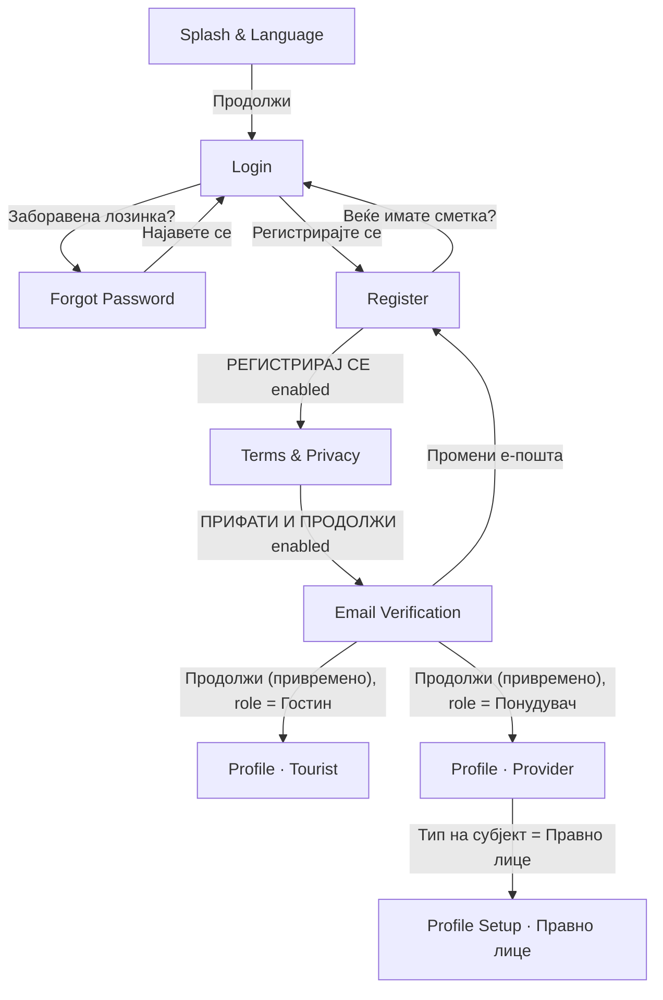
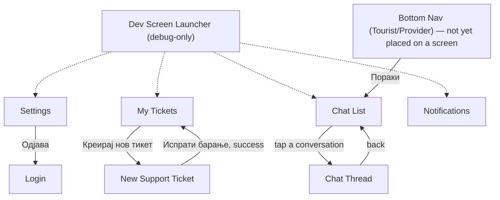

# Bulka — Project Progress

_Rural tourism app for Macedonia (Flutter). This page summarizes what has been built so far, how it's structured, and what's still open. Copy/paste this into the GitHub Wiki (e.g. as `Home` or `Project-Progress`) once you push the code._

## Where we left off

Last worked on: a **debug-only Dev Screen Launcher** (`lib/dev/dev_launcher_screen.dart`) that lists every implemented screen and opens each directly — added because most of the screens below (Notifications, Chat, Support, Settings) have no real navigation entry point yet. Next up, whenever we pick this back up:

- **No screen has a real "home" shell yet.** Splash → Login/Register → Profile is still the only fully-wired flow. Notifications, Chat List/Thread, My Tickets/New Ticket and Settings all exist and work, but the *only* way to reach most of them today is the Dev Launcher (My Tickets/New Ticket/Settings) or the bottom nav's "Пораки" tab (Chat List only). This is intentional per explicit instructions each time ("don't invent a nav entry yet") — but it means a **Home/Dashboard screen for each role, wired to `TouristBottomNav`/`ProviderBottomNav`, is the natural next piece of work** to actually tie the app together.
- **`TouristBottomNav`/`ProviderBottomNav` (`lib/widgets/app_bottom_nav.dart`) are built but not placed on any screen.** Only their "Пораки" tab is wired (→ Chat List, with a live unread badge); the other 4 tabs per role (Дома/Пребарај/Резервации/Профил for Tourist, Табла/Понуди/Календар/Профил for Provider) call an `onOtherTap` callback that nothing currently supplies — there's simply no Home/Search/Bookings/Dashboard/Offers/Calendar screen to route to yet.
- **Choose Role screen** (from the original project scaffold) still has no Figma frame implemented.
- Everything below this point reflects the actual current state of the code, not just intentions — cross-check `lib/` if anything here looks stale.

## Status at a glance

| Screen | Status | Notes |
|---|---|---|
| Splash & Language | ✅ Implemented | Vertically responsive on short devices |
| Login | ✅ Implemented | Google sign-in button is UI-only |
| Forgot Password | ✅ Implemented | "Send code" is UI-only |
| Register | ✅ Implemented | Submit gated on Terms checkbox |
| Terms & Privacy Acceptance | ✅ Implemented | Submit gated on all 3 consents |
| Email Verification | ✅ Implemented (with a temporary dev button, see below) | "Resend" is UI-only |
| Profile (Tourist) | ✅ Implemented | Pre-filled from registration data; Save gated on an actual edit |
| Profile (Provider · Физичко лице) | ✅ Implemented | Pre-filled from registration data; Save gated on an actual edit |
| Profile Setup (Provider · Правно лице) | ✅ Implemented | Full alternate screen (logo upload, business fields) shown when the subject-type toggle is set to "Правно лице" — see notes below |
| Bottom Nav — Tourist / Provider | ✅ Implemented (not yet placed on a screen) | Both variants built as one shared `BottomNavBar`; only "Пораки" is wired |
| Settings | ✅ Implemented | No screen navigates here yet; "Одjава" really logs out to Login |
| Notifications | ✅ Implemented | No screen navigates here yet (see "Where we left off") |
| Messages · Chat List | ✅ Implemented | Reachable via "Пораки" on the bottom nav (once placed on a screen) |
| Messages · Chat Thread | ✅ Implemented | Reachable from Chat List only |
| Support · My Tickets | ✅ Implemented | No screen navigates here yet — reachable via Dev Launcher only |
| Support · New Ticket | ✅ Implemented | Reachable from My Tickets only |
| Dev Screen Launcher | ✅ Implemented (debug-only) | Boots automatically in debug builds; never present in release |
| Choose Role | ❌ Not started | No Figma frame implemented yet |
| Home / Dashboard (either role) | ❌ Not started | Needed to actually host the bottom nav bars |
| Backend / API integration | ❌ Not started | All actions are local UI state only |

All screens above were built directly from the team's Figma file ("Rural Tourism"), matched frame-by-frame — colors, typography, spacing, and assets pulled from Figma via MCP rather than eyeballed.

## Navigation flow implemented so far

The original registration flow is unchanged and still the only "start to finish" wired path:



Every button press above is real `Navigator` push/pop — nothing is a placeholder route, **except** the **temporary "Продолжи (привремено)" button** on the Email Verification screen: there's no real "email confirmed" signal yet (no backend), so this button exists purely so the flow can be clicked through end-to-end during development. It now routes based on which role was picked on Register (Гостин → Tourist profile, Понудувач → Provider profile) and has a `TODO` marking it for removal once the backend can verify the email and drive that navigation automatically. On the Provider Profile screen, the "Правно лице" pill of the Subject Type toggle swaps the entire screen body (header, avatar, fields, everything below) in place — it isn't a separate navigation hop, just conditional rendering within the same screen/route.

**A second, separate cluster of screens exists with its own internal navigation but no entry point from the flow above yet:**



Solid arrows are real, working `Navigator` transitions. The dashed arrows from the Dev Launcher exist only in debug builds (see "Dev Screen Launcher" below) — in a release build there is currently **no way to reach Settings, My Tickets, New Ticket, or Notifications at all**, which is the main gap called out in "Where we left off".

**Data flow.** The name/email/phone entered on Register are carried forward via a small `RegistrationProfile` model (`lib/models/registration_profile.dart`) passed as a constructor parameter from screen to screen (Register → Terms → Email Verification → whichever Profile screen matches the chosen role) — no state-management library, just plain data passed down. Both profile screens are pre-filled with that real data instead of hardcoded placeholders.

**Shared feature state** (Notifications, Chat, Support tickets) uses a different, equally lightweight pattern: a `ChangeNotifier` singleton per feature (`NotificationsController.instance`, `ChatController.instance`, `SupportTicketController.instance` under `lib/services/`), listened to via `ListenableBuilder`/manual `addListener`+`setState`. This is still "no new state-management package" — just Flutter's own `ChangeNotifier` — but unlike `RegistrationProfile` it isn't passed down the widget tree; any screen or widget can read the same singleton, which is what lets e.g. the bottom nav's unread badge and the Chat List screen stay in sync automatically.

## Screen-by-screen notes

**Splash & Language** (`lib/screens/splash_screen/`)
Solid green background, logo, title/subtitle, language switch (MK/SQ/EN), CTA. Made vertically responsive after an overflow was reported on a Galaxy S8+ (360×740): the gaps between elements shrink proportionally under tight height via `Flexible`, and the logo itself only shrinks (down to a floor) if spacing alone isn't enough — normal/tall screens render pixel-identical to before. Covered by `test/splash_screen_responsive_test.dart`.

**Login** (`lib/screens/login_screen/`)
Dark header band (back arrow, language switch, logo, title) + white body (email/password fields, "forgot password?", primary + Google buttons, footer link to Register).

**Forgot Password** (`lib/screens/forgot_password_screen/`)
Same header pattern (no language switch), icon badge, heading, email field, submit button, footer link back to Login.

**Register** (`lib/screens/register_screen/`)
Guest/Provider role toggle, 5 form fields (name, email, phone, password, confirm password), Terms & Privacy checkbox with inline links, submit button. **The submit button is disabled until the checkbox is checked** — this was a deliberate requirement, not a bug.

**Terms & Privacy Acceptance** (`lib/screens/terms_privacy_screen/`)
Scrollable legal-text card (Terms + Privacy sections) plus 3 separate consent checkboxes. Submit is disabled until **all three** are checked.

**Email Verification** (`lib/screens/email_verification_screen/`)
Centered confirmation screen: icon, instructions, the target email address, a "not verified" status badge, a resend button, and a link back to Register to change the email.

**Profile · Tourist** (`lib/screens/profile_screen/`)
The screen a tourist lands on after registering: avatar (auto-generated initials, e.g. "Јована Јованова" → "ЈЈ"), name/email/role badge, an editable "Лични податоци" (Personal Data) form (name, email, phone, **city/location**), reservation/favorites stat cards, and a "Зачувај промени" (Save changes) button.
- Name, email, and phone are **pre-filled from what was entered at registration** via the `RegistrationProfile` model.
- **City/Location** is not collected at registration — it's new to this screen, starts empty, and is meant to be saved to the backend the same way as the rest of the user's data once that exists (currently a `TODO`, see Known gaps).
- The Save button starts **disabled** (shown in a muted green, matching Figma's mockup) and only enables once a field's value actually differs from what was last saved — same disabled-until-valid pattern as Register/Terms & Privacy. `PrimaryButton` was extended with optional disabled-color overrides to support this without forking a new button widget.
- Reservations and Favorite Places both start at **0** — there's no reservations/favorites system yet, so these are just static counts waiting to be wired to real data.

**Profile · Provider (Физичко лице)** (`lib/screens/provider_profile_screen/`)
The screen a provider lands on after registering, for the "individual person" subject type. Avatar/name/email header (same pattern as Tourist), a **"Тип на субјект" (Subject Type) toggle** (Физичко лице / Правно лице), an editable "Лични податоци" form (name, phone — email is display-only here, unlike Tourist), an "Информации за понудата" (Offer Information) section (offer name, an expandable multi-select **category checklist** — Сместување/Гастрономија/etc., location), stat cards (Active Offers, Average Rating), and the same disabled-until-edited "Зачувај промени" button pattern.
- Name and phone are pre-filled from registration; offer name, categories, and location are new to this screen (empty by default, "Сместување" pre-checked to match Figma) and save the same in-memory-only way as Tourist's city field, with a `TODO` for real persistence.
- **Verification badge** defaults to "НЕ Е ВЕРИФИКУВАН" (not verified, gold), not Figma's literal "ВЕРИФИКУВАН" (verified, mint) — same reasoning as the 0-count stats: nothing has actually verified this provider yet. `StatusBadge` supports both color schemes.
- **Active Offers and Average Rating start at 0** ("0.0 ★"), same convention as Tourist's counters.

**Profile Setup · Provider (Правно лице / legal entity)** (same file, `provider_profile_screen.dart`)
Selecting "Правно лице" on the Subject Type toggle swaps the **entire** screen body to a distinct Figma frame ("17 – Provider · Profile Setup"), not just the personal-data fields — this was a deliberate call after confirming with the user, since the legal-entity frame has its own header ("Поставување профил" + subtitle), no stat cards, no verified badge, and a genuinely different field set:
- An editable **company logo upload** (`image_picker`, camera or gallery via a bottom sheet) replacing the static initials avatar.
- Company fields: company name, responsible person, phone, email (all real inputs; responsible person/phone/email pre-fill from `RegistrationProfile`).
- "Деловни податоци" (Business Details): tax ID (ЕДБ), the same category checklist component reused from the individual variant, business address.
- "Дополнителни контакти" (Additional Contacts): a dynamically growable list of contact fields (+ add / × remove).
- "Фотографии" (Photos): a real multi-image picker grid with a dashed "add" tile (shared `DashedBorderBox` widget — see Architecture) and per-photo remove.
- Save button reads "Зачувај и продолжи" here (vs. "Зачувај промени" for the individual variant) and follows the same disabled-until-edited pattern.

**Bottom Nav — Tourist / Provider** (`lib/widgets/bottom_nav_bar.dart`, `lib/widgets/app_bottom_nav.dart`)
`BottomNavBar` is one generic, reusable 5-tab widget (icons/labels/selection/optional per-tab unread badge) — Tourist (`touristBottomNavItems`: Дома/Пребарај/Резервации/Пораки/Профил) and Provider (`providerBottomNavItems`: Табла/Понуди/Календар/Пораки/Профил) just supply different tab data, matching Figma's `DS/Nav/Tourist`/`DS/Nav/Provider` components exactly. `TouristBottomNav`/`ProviderBottomNav` in `app_bottom_nav.dart` wrap it with the one bit of real behavior it needs: the "Пораки" tab (index 3 in both) opens **Chat List** and shows a live badge from `ChatController.instance.totalUnreadMessages`. (This tab briefly opened the *Notifications* screen instead — an early mistake, corrected once Chat was built; Notifications now has its own separate screen/controller/badge and is not reachable from here.) Every other tab forwards to an `onOtherTap` callback the caller must supply — there is no Home/Search/Bookings/Dashboard/Offers/Calendar screen yet, so nothing supplies one today, and **neither wrapper is placed on any screen's `Scaffold` yet** (see "Where we left off").

**Settings** (`lib/screens/settings_screen/`)
Dark header ("Поставки"), language row (a new "light surface" variant of the shared `LanguageSwitch` widget, for use on white backgrounds), a real working notifications on/off toggle (custom-built — Flutter's `Switch` can't be shrunk to Figma's exact 44×24 track), a privacy section with a "Преземи ги моите податоци" button (`TODO`) and a destructive-styled "Побарај бришење на сметката" button (`TODO`, uses a red-color override added to `SecondaryButton`), and an "Одјава" (Logout) button that is **fully functional** — it clears the navigation stack and routes to `LoginScreen` via `pushAndRemoveUntil`. No screen currently navigates *to* Settings.

**Notifications** (`lib/screens/notifications_screen/`, `lib/services/notifications_controller.dart`)
Header with a subtitle that's always **derived**, never hardcoded — "N непрочитани известувања" comes from counting `NotificationItem`s where `isRead == false` in `NotificationsController` (a `ChangeNotifier` singleton seeded with mock data reproducing the Figma example). Cards use a distinct unread (`agroGreen100`) vs. read (`agroCream100`) background; tapping a card calls `markAsRead`, which updates the card style and the header count immediately via the listener the screen registers on the controller. No screen currently navigates to Notifications.

**Messages · Chat List** (`lib/screens/chat_list_screen/`) and **Chat Thread** (`lib/screens/chat_thread_screen/`), plus `lib/services/chat_controller.dart`
`ChatController` (same singleton pattern as Notifications) holds `ChatConversation`s, each owning its own `ChatMessage` list; both `unreadCount` (per conversation) and `totalUnreadMessages` (across all conversations, used for the nav badge) are **derived getters** off the messages, never separately tracked. Chat List renders participant/avatar-initials/reservation-or-ticket context line/latest-message preview/relative timestamp/unread badge straight from that data; tapping a row calls `markConversationRead` **before** navigating (so the badge — everywhere — updates before the thread even finishes animating in), then pushes Chat Thread for that conversation. Chat Thread has its own bespoke header (back arrow, small bare logo mark, avatar, name + context — different enough from the shared `ScreenHeader` that it's built inline), a date divider, and incoming (cream, bordered) vs. outgoing (green, no border) bubbles. Sending a message appends a local outgoing `ChatMessage` via `ChatController.sendMessage`, clears the input, and auto-scrolls — no backend/WebSocket, by design; the controller is the one place a real implementation would plug in later.

**Support · My Tickets** (`lib/screens/my_tickets_screen/`) and **New Support Ticket** (`lib/screens/new_support_ticket_screen/`), plus `lib/services/support_ticket_controller.dart`
`SupportTicketController` (same pattern again) is seeded with the 4 Figma mock tickets. My Tickets renders ticket cards straight from `controller.tickets` — number, a status pill (reusing the shared `StatusBadge` widget), title, and a "Последна промена: пред X" relative-time label. **Ticket status is a `TicketStatus` enum** (`open`/`inProgress`/`resolved`) with `.label`/`.pillTextColor` getters, so the ОТВОРЕН/ВО ТЕК/РЕШЕН strings and their colors live in exactly one place rather than being scattered through widget code. "Креирај нов тикет" pushes New Ticket, which has a category dropdown, title field, a fixed-height description textarea, and an **attachment box that's genuinely functional**: tapping it opens a sheet with Камера/Галерија (via `image_picker`) or Документ (via the newly-added `file_picker` package, for arbitrary file types Figma's "или документ" calls for that `image_picker` alone can't cover); once picked, the dashed box is replaced by a row showing filename + size with tap-to-replace and a × to remove. Submitting (disabled until title + description are non-empty) calls `SupportTicketController.createTicket` — which sets `status: open`, `createdAt`/`updatedAt: now` — and pops back to My Tickets, where the new ticket is already visible since both screens read the same shared list. No screen currently navigates to My Tickets except the Dev Launcher.

**Dev Screen Launcher** (`lib/dev/dev_launcher_screen.dart`) — **debug-only, not a Figma screen**
A plain (non-design-system) list, grouped by flow, of every screen implemented so far; tapping a row does a normal `Navigator.push` straight to the real screen widget with its real controllers/state — nothing here is a copy or a mock. Wired in via `main.dart`: `home: kDebugMode ? const DevLauncherScreen() : const SplashScreen()`. Since `kDebugMode` is a compile-time constant that's `false` in profile/release builds, this has **zero effect on production** — release always boots to `SplashScreen` exactly as before. Adding a newly-built screen to the list is one import + one line. Two entries need synthesized constructor args to open standalone (`TermsPrivacyScreen` gets a small mock `RegistrationProfile`; `ChatThreadScreen` gets `ChatController.instance.conversations.first.id`) — everything else uses its real default constructor.

## Architecture / design system

Everything is built from shared constants and reusable widgets rather than hardcoded values, per the project's convention:

- **`lib/core/constants/app_colors.dart`** — the full color palette pulled from Figma variables (`agro-green-700`, `agro-forest-950`, etc.), organized into a shared "brand colors" section (reused across screens) plus per-screen sections, each with comments noting exactly where each color is used.
- **`lib/core/constants/app_dimensions.dart`** — same pattern for spacing, radii, and font sizes. Values genuinely shared across screens (e.g. the `DS/Button`, `DS/Input/Field`, `DS/Checkbox`, Header Band, and "compact header with subtitle" specs from Figma) live under a shared `ds*` prefix; screen-specific values are grouped per screen. This consolidation keeps happening as new screens land — e.g. the Provider Setup and New Support Ticket headers now share `dsHeaderSubtitleGap`/`dsHeaderSubtitleTitleFontSize` instead of each having their own copy.
- **`lib/core/constants/app_strings.dart`** — all Macedonian UI copy, with shared strings factored out once instead of duplicated per screen (e.g. `imageSourceCamera`/`imageSourceGallery` are now shared between the Provider logo picker and the ticket attachment picker; relative-time suffixes are shared between Notifications and Chat List).
- **`lib/core/utils/relative_time.dart`** — the "2 мин / 1 ч / 1 ден" short relative-timestamp formatter, shared by Notifications and Chat List (extracted out of Notifications once Chat List needed the identical logic).
- **`lib/widgets/`** — reusable components mapped 1:1 to Figma's design-system components: `ScreenHeader`, `LanguageSwitch` (now with a light/dark `surface` variant), `PrimaryButton`/`SecondaryButton` (both now support color overrides for one-off variants like destructive buttons, without forking new widgets), `LabeledTextField`, `RoleToggle`, `SubjectTypeToggle`, `AppCheckbox`, `CollapsibleChecklist`, `StatusBadge` (now with optional size overrides), `BottomNavBar` + `app_bottom_nav.dart`'s `TouristBottomNav`/`ProviderBottomNav`, `DashedBorderBox` (the dashed-border painter, extracted out of the Provider Photos tile once the ticket attachment box needed the identical treatment).
- **`lib/models/`** — `RegistrationProfile` (registration → profile data flow), `NotificationItem`, `ChatMessage`/`ChatConversation`, `SupportTicket`/`SupportAttachment`/`TicketStatus`. All the newer models are shaped to map directly onto a future API response (id/…/timestamp/status fields) so the mock data behind them can be swapped out without touching anything that reads them.
- **`lib/services/`** — `NotificationsController`, `ChatController`, `SupportTicketController`: one `ChangeNotifier` singleton per feature (`Feature.instance`), each seeded with mock data reproducing its Figma example, each the single shared source of truth for that feature's screens *and* any badge elsewhere in the UI (e.g. the bottom nav's unread-messages badge reads the exact same `ChatController.instance` the Chat List screen does). No new state-management package was introduced for any of this — it's all built on Flutter's own `ChangeNotifier`/`ListenableBuilder`.
- **`lib/dev/`** — the debug-only Dev Screen Launcher (see above); not part of the production app.
- **Fonts**: Montserrat Regular/Medium/SemiBold/Bold/ExtraBold (400–800) are all bundled locally under `fonts/` and registered in `pubspec.yaml`.
- **New dependencies**: `image_picker` (camera/gallery — Provider logo/photos, ticket image attachments) and `file_picker` (arbitrary document attachments for support tickets). Both are real, functional integrations, not stubs — see the relevant screen notes above for platform permission changes (`ios/Runner/Info.plist`, `android/.../AndroidManifest.xml`) made alongside `image_picker`.

## Known gaps / not yet implemented

- **No backend or API wiring anywhere.** Every "submit"/"save"/"send" action across every screen (login, register, resend code, reset password, terms acceptance, both profile saves, notification read-state, chat send, ticket create/attachment) is local state only, with a `TODO` marking where a real API call would go. This was explicitly out of scope for this phase throughout.
- **Most of the newer screens have no real navigation entry point.** Settings, Notifications, My Tickets, and New Ticket are only reachable via the Dev Screen Launcher (debug builds only) or each other's internal navigation — none of them are linked from anywhere a real user could reach in a release build. This is intentional per instructions given each time these screens were built ("don't invent a nav entry yet"), but it's the most consequential gap: **there is currently no screen a signed-in user actually lands on** besides the two Profile screens.
- **`TouristBottomNav`/`ProviderBottomNav` are built but not placed on any screen**, and 4 of their 5 tabs per role have no destination screen to route to yet (Дома/Пребарај/Резервации/Профил for Tourist; Табла/Понуди/Календар/Профил for Provider). Building a Home/Dashboard screen per role to host these — and to finally give Settings/My Tickets a real, discoverable path — is the natural next step.
- **Cross-screen data flow is wired for the registration → profile path** and, separately, within each of the Notifications/Chat/Support feature clusters — but nothing connects those two groups yet: e.g. login doesn't populate a profile, and there's no concept of a signed-in "current user" spanning all of it.
- **No field-level validation** on the form screens beyond the checkbox/edit-gated submit buttons (Register's Terms checkbox, Terms & Privacy's 3 consents, both Profile screens' "has anything actually changed" check, New Ticket's title/description non-empty check).
- **Reservations/Favorite Places (Tourist)** and **Active Offers/Average Rating (Provider)** are hardcoded at 0 — no reservations/favorites/offers/reviews system exists yet to drive them.
- **Verification status** on the Provider profile is hardcoded to "not verified" — there's no verification workflow yet.
- **Choose Role screen** (mentioned in the codebase's original scaffold) hasn't been designed/built against a Figma frame yet.
- **Temporary dev button** on Email Verification (see Navigation flow above) needs to be removed/replaced once the backend can confirm email verification and drive that navigation automatically.
- **Chat/attachment data is local-only and in-memory** — closing the app loses everything created during the session (new tickets, sent chat messages, read/unread state). No persistence layer exists yet for any of it.
- Test coverage is currently limited to the Splash screen's responsive-layout behavior; the rest of the flow has been verified via `flutter analyze` and manual/visual comparison against Figma screenshots, not automated widget tests.

## Running the project

```bash
flutter pub get
flutter run          # debug build boots into the Dev Screen Launcher — see below
flutter analyze
flutter test
```

**Testing an individual screen without walking the real flow:** just `flutter run` (no `--release`) — debug builds boot straight into the Dev Screen Launcher (`lib/dev/dev_launcher_screen.dart`) instead of Splash, and every implemented screen is one tap away, using its real widget and real controllers/state. This has no effect on release builds, which always start at `SplashScreen`.
claude --resume b372ca81-4bc1-42ba-95ad-bd6dca19fb83