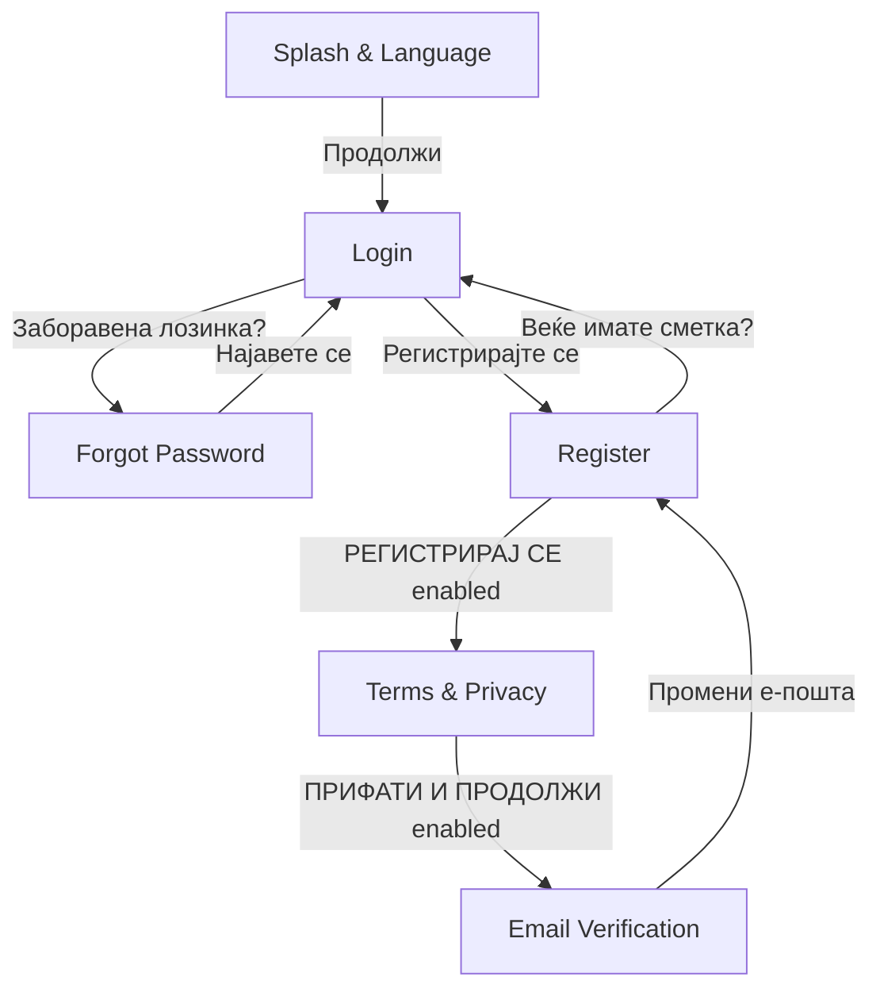

# Bulka — Project Progress

_Rural tourism app for Macedonia (Flutter). This page summarizes what has been built so far, how it's structured, and what's still open. Copy/paste this into the GitHub Wiki (e.g. as `Home` or `Project-Progress`) once you push the code._

## Status at a glance

| Screen | Status | Notes |
|---|---|---|
| Splash & Language | ✅ Implemented | Vertically responsive on short devices |
| Login | ✅ Implemented | Google sign-in button is UI-only |
| Forgot Password | ✅ Implemented | "Send code" is UI-only |
| Register | ✅ Implemented | Submit gated on Terms checkbox |
| Terms & Privacy Acceptance | ✅ Implemented | Submit gated on all 3 consents |
| Email Verification | ✅ Implemented (with a temporary dev button, see below) | "Resend" is UI-only |
| Choose Role | ❌ Not started | No Figma frame implemented yet |
| Backend / API integration | ❌ Not started | All actions are local UI state only |

All six screens above were built directly from the team's Figma file ("Rural Tourism"), matched frame-by-frame — colors, typography, spacing, and assets pulled from Figma via MCP rather than eyeballed.

## Navigation flow implemented so far



Every button press above is real `Navigator` push/pop — nothing is a placeholder route. The one exception is a **temporary "Продолжи (привремено)" button** on the Email Verification screen: there's no screen after it yet, so this button exists purely so the flow can be clicked through end-to-end during development. It's a no-op with a `TODO` marking it for removal once the post-verification flow is designed and the backend can drive that navigation automatically.

## Screen-by-screen notes

**Splash & Language** (`lib/screens/splash_screen/`)
Solid green background, logo, title/subtitle, language switch (MK/SQ/EN), CTA. Made vertically responsive after an overflow was reported on a Galaxy S8+ (360×740): the gaps between elements shrink proportionally under tight height via `Flexible`, and the logo itself only shrinks (down to a floor) if spacing alone isn't enough — normal/tall screens render pixel-identical to before. Covered by `test/splash_screen_responsive_test.dart`.

**Login** (`lib/screens/login_screen/`)
Dark header band (back arrow, language switch, logo, title) + white body (email/password fields, "forgot password?", primary + Google buttons, footer link to Register).

**Forgot Password** (`lib/screens/forgot_password_screen/`)
Same header pattern (no language switch), icon badge, heading, email field, submit button, footer link back to Login.

**Register** (`lib/screens/register_screen/`)
Guest/Provider role toggle, 5 form fields (name, email, phone, password, confirm password), Terms & Privacy checkbox with inline links, submit button. **The submit button is disabled until the checkbox is checked** — this was a deliberate requirement, not a bug.

**Terms & Privacy Acceptance** (`lib/screens/terms_privacy_screen/`)
Scrollable legal-text card (Terms + Privacy sections) plus 3 separate consent checkboxes. Submit is disabled until **all three** are checked.

**Email Verification** (`lib/screens/email_verification_screen/`)
Centered confirmation screen: icon, instructions, the target email address, a "not verified" status badge, a resend button, and a link back to Register to change the email.

## Architecture / design system

Everything is built from shared constants and reusable widgets rather than hardcoded values, per the project's convention:

- **`lib/core/constants/app_colors.dart`** — the full color palette pulled from Figma variables (`agro-green-700`, `agro-forest-950`, etc.), organized into a shared "brand colors" section (reused across screens) plus per-screen sections, each with comments noting exactly where each color is used.
- **`lib/core/constants/app_dimensions.dart`** — same pattern for spacing, radii, and font sizes. Values genuinely shared across screens (e.g. the `DS/Button`, `DS/Input/Field`, `DS/Checkbox` and Header Band specs from Figma) live under a shared `ds*` prefix; screen-specific values are grouped per screen.
- **`lib/core/constants/app_strings.dart`** — all Macedonian UI copy, with shared strings (e.g. "Е-пошта", "Лозинка") factored out once instead of duplicated per screen.
- **`lib/widgets/`** — reusable components mapped 1:1 to Figma's design-system components: `ScreenHeader` (the dark header band, used by Login/Forgot Password/Register/Terms), `LanguageSwitch`, `PrimaryButton`, `SecondaryButton`, `LabeledTextField`, `RoleToggle`, `AppCheckbox`, `GoldBadge`.
- **Fonts**: Montserrat Regular/Medium/SemiBold/Bold/ExtraBold (400–800) are all bundled locally under `fonts/` and registered in `pubspec.yaml`.

## Known gaps / not yet implemented

- **No backend or API wiring.** Every "submit" action (login, register, resend code, reset password, terms acceptance) is a `TODO` no-op — this was explicitly out of scope for this phase.
- **No cross-screen data flow yet.** For example, the email shown on the Email Verification screen isn't the one actually entered on Register — there's no shared form state/model wiring the screens together yet.
- **No field-level validation** on the form screens beyond the two checkbox-gated submit buttons (Register's Terms checkbox, Terms & Privacy's 3 consents).
- **Choose Role screen** (mentioned in the codebase's original scaffold) hasn't been designed/built against a Figma frame yet.
- **Temporary dev button** on Email Verification (see Navigation flow above) needs to be removed once the real post-verification screen(s) and backend trigger exist.
- Test coverage is currently limited to the Splash screen's responsive-layout behavior; the rest of the flow has been verified via `flutter analyze` and manual/visual comparison against Figma screenshots, not automated widget tests.

## Running the project

```bash
flutter pub get
flutter run
flutter analyze
flutter test
```
