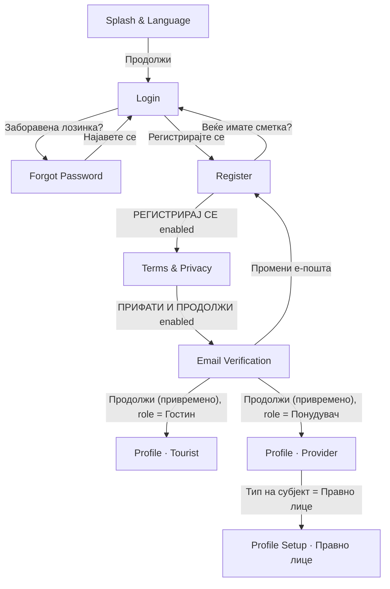
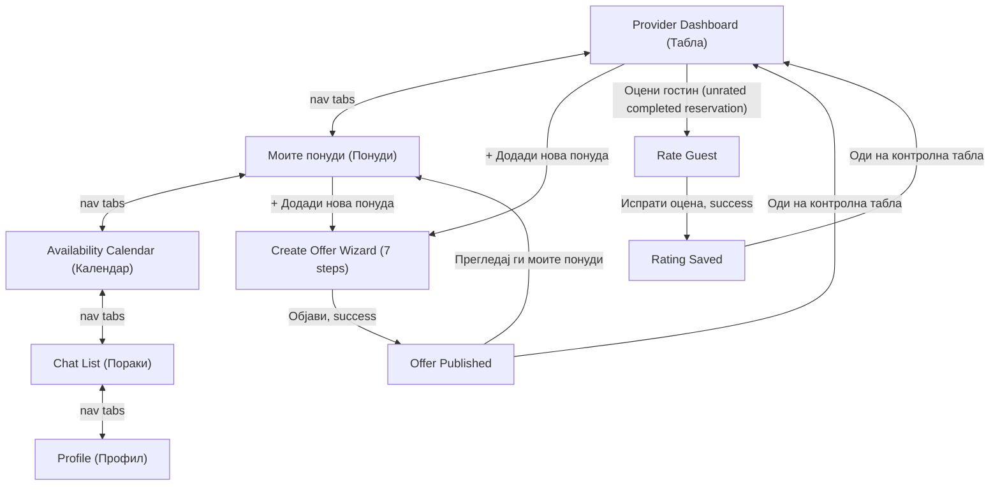
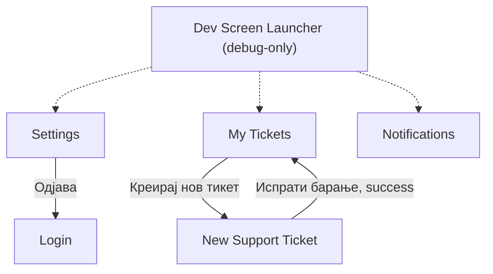

# Bulka — Project Progress

_Rural tourism app for Macedonia (Flutter). This page summarizes what has been built so far, how it's structured, and what's still open. Copy/paste this into the GitHub Wiki (e.g. as `Home` or `Project-Progress`) once you push the code._

## Where we left off

Last worked on: the **Provider "Rate Guest" flow** (Dashboard's "Оцени гостин" → star rating form → "Оценката е зачувана!" success screen), plus two bugfixes found while testing it: **Provider Offers' listing images weren't rendering** (always showed the flat placeholder, even for listings with real picked photos) and **Provider Profile's "Активни понуди"/"Просечна оценка" stat cards were still hardcoded to 0** from before `ProviderListingController` existed. Both are fixed. Next up, whenever we pick this back up:

- **The Tourist role still has none of the Provider-side shell work.** `TouristBottomNav` is still built but not placed on any screen, and there's no Tourist Home/Search/Bookings screen at all. This remains the clearest next piece of work to bring the two roles to parity.
- **No design exists yet for an "already rated" visual state.** Once a completed reservation has been rated, tapping "Оцени гостин" again is safely a no-op (the Dashboard checks `GuestRatingController.hasRating` before navigating at all) — but the button still just reads "Оцени гостин" with no visual difference, per explicit instruction not to invent a design that doesn't exist in Figma yet. Flagged with a `TODO` right at that spot in `provider_dashboard_screen.dart`.
- **Settings, Notifications, My Tickets/New Ticket still have no real navigation entry point** for either role — only the Dev Launcher reaches them.
- **Three explicit `TODO` actions remain on the Provider Offers screen**: "Уреди" (edit an active listing), "Уреди и поднеси повторно" (edit + resubmit a rejected listing) — both need an **Edit Listing screen that doesn't exist yet**, deliberately not invented per instructions each time it came up.
- Everything below this point reflects the actual current state of the code, not just intentions — cross-check `lib/` if anything here looks stale.

## Status at a glance

| Screen | Status | Notes |
|---|---|---|
| Splash & Language | ✅ Implemented | Vertically responsive on short devices |
| Login | ✅ Implemented | Google sign-in button is UI-only |
| Forgot Password | ✅ Implemented | "Send code" is UI-only |
| Register | ✅ Implemented | Submit gated on Terms checkbox |
| Terms & Privacy Acceptance | ✅ Implemented | Submit gated on all 3 consents |
| Email Verification | ✅ Implemented (with a temporary dev button, see below) | "Resend" is UI-only |
| Profile (Tourist) | ✅ Implemented | Pre-filled from registration data; Save gated on an actual edit |
| Profile (Provider · Физичко лице) | ✅ Implemented | Active Offers/Average Rating stat cards now derive from real listing data |
| Profile Setup (Provider · Правно лице) | ✅ Implemented | Full alternate screen (logo upload, business fields) shown when the subject-type toggle is set to "Правно лице" |
| Bottom Nav — Tourist / Provider | ✅ Implemented | Provider variant fully wired (all 5 tabs); Tourist only "Пораки" wired, not placed on any screen |
| Provider Dashboard | ✅ Implemented | Hosts `ProviderBottomNav`; "Оцени гостин" now opens the real Rate Guest flow |
| Provider · Моите понуди (Offers) | ✅ Implemented | Listing photos now render correctly; 2 of its per-card actions are `TODO` (need an Edit Listing screen) |
| Provider · Availability Calendar | ✅ Implemented | Reachable via nav "Календар" |
| Provider · Create Offer Wizard (7 steps + Review) | ✅ Implemented | Reachable via both "+ Додади нова понуда" buttons (Dashboard, Offers) |
| Provider · Offer Published (Success) | ✅ Implemented | Reached only after a successful publish |
| Provider · Rate Guest | ✅ Implemented | Opened only from a completed reservation's "Оцени гостин" on the Dashboard |
| Provider · Rating Saved (Success) | ✅ Implemented | Reached only after a successful rating submit |
| Settings | ✅ Implemented | No screen navigates here yet; "Одjава" really logs out to Login |
| Notifications | ✅ Implemented | No screen navigates here yet |
| Messages · Chat List | ✅ Implemented | Reachable via "Пораки" on the Provider bottom nav |
| Messages · Chat Thread | ✅ Implemented | Reachable from Chat List only |
| Support · My Tickets | ✅ Implemented | No screen navigates here yet — reachable via Dev Launcher only |
| Support · New Ticket | ✅ Implemented | Reachable from My Tickets only |
| Dev Screen Launcher | ✅ Implemented (debug-only) | Boots automatically in debug builds; never present in release |
| Choose Role | ❌ Not started | No Figma frame implemented yet |
| Tourist Home / Dashboard | ❌ Not started | Needed to host `TouristBottomNav` the same way Provider Dashboard hosts `ProviderBottomNav` |
| Edit Listing screen | ❌ Not started | Blocks 2 Offers-screen actions |
| Guest-facing rating display | ❌ Not started | Ratings are stored provider-side only — see "Known gaps" |
| Backend / API integration | ❌ Not started | All actions are local UI state only |

All screens above were built directly from the team's Figma file ("Rural Tourism"), matched frame-by-frame — colors, typography, spacing, and assets pulled from Figma via MCP rather than eyeballed.

## Navigation flow implemented so far

The original registration flow is unchanged and still the only "start to finish" wired path for a brand new user:



**The Provider role has a real, fully-connected shell**, all through `ProviderBottomNav` (every tap either switches tabs in place or `pushReplacement`s to the target screen — never a silent stacked push):



Note this diagram is a simplification — Dashboard/Offers/Calendar/Chat/Profile don't literally form a ring; every nav tap resolves independently to whichever of those 5 screens was tapped, from whichever one you're currently on. See "Provider Create Offer Wizard" and "Provider Rate Guest" below for exactly how exiting/cancelling and publishing/submitting manage the navigation stack, which is more involved than a simple push/pop.

**A third, separate cluster of screens still has no entry point from either flow above:**



Solid arrows are real, working `Navigator` transitions. Dashed arrows exist only in debug builds — in a release build there is currently **no way to reach Settings, My Tickets, New Ticket, or Notifications at all**.

**Data flow.** The name/email/phone entered on Register are carried forward via a small `RegistrationProfile` model passed as a constructor parameter screen-to-screen — no state-management library, just plain data passed down.

**Shared feature state** (Notifications, Chat, Support tickets, Provider listings, Reservations, Availability, Guest ratings) all use the same pattern: a `ChangeNotifier` singleton per feature under `lib/services/`, listened to via manual `addListener`+`setState`. Any screen or widget can read the same singleton — this is what lets, for example, accepting a reservation on the Dashboard, publishing a new listing from the wizard, or submitting a guest rating, be visible everywhere that depends on it immediately with zero manual cross-screen sync.

**The Create Offer wizard uses a different, narrower pattern on purpose**: its `CreateListingDraft` is a plain **mutable object scoped to one wizard session** (owned by the wizard screen's own `State`, not a singleton) — see the wizard's own notes below for why.

## Screen-by-screen notes

**Splash & Language** (`lib/screens/splash_screen/`)
Solid green background, logo, title/subtitle, language switch (MK/SQ/EN), CTA. Vertically responsive (Galaxy S8+ / 360×740 tested). Covered by `test/splash_screen_responsive_test.dart`.

**Login / Forgot Password / Register / Terms & Privacy / Email Verification**
Unchanged since the last update. Register's role toggle drives which Profile screen Email Verification's temporary dev button routes to.

**Profile · Tourist** (`lib/screens/profile_screen/`)
Pre-filled from `RegistrationProfile`; Save disabled until an actual edit is made; Reservations/Favorite Places hardcoded at 0 (no such system exists yet).

**Profile · Provider (Физичко лице) / Profile Setup · Provider (Правно лице)** (`lib/screens/provider_profile_screen/`, one file)
Selecting "Правно лице" swaps the **entire** screen body (own header, logo upload, company fields, business details, additional contacts, real multi-photo picker) rather than just the personal-data fields. **Bugfix this round**: the "Активни понуди"/"Просечна оценка" stat cards were still `static const` hardcoded to `0` from before `ProviderListingController` existed — they're now derived getters (`ProviderListingController.instance.activeListingsCount`, and an average of active listings' own `rating` values), and the screen listens to the controller so both update live as listing statuses change elsewhere (e.g. a wizard-published listing getting approved, or an archived one being reactivated).

**Bottom Nav — Tourist / Provider** (`lib/widgets/bottom_nav_bar.dart`, `lib/widgets/app_bottom_nav.dart`)
Unchanged since the last update — `ProviderBottomNav` resolves all 5 tabs itself; `TouristBottomNav` still only has "Пораки" wired and isn't placed on any screen.

**Provider Dashboard** (`lib/screens/provider_dashboard_screen/`)
"Контролна табла" — greeting derived from the provider's first listing's title, 3 counters derived from `ProviderListingController`/`ReservationController`, a "Резервации кои чекаат" section with working Прифати/Одбиј, and a "Завршени резервации" section. **"Оцени гостин" is now fully wired**: `_handleRateGuest(reservation)` checks `GuestRatingController.hasRating(reservation.id)` first — if already rated, it does nothing (no re-entry, no duplicate); otherwise it pushes `RateGuestScreen` with that exact `Reservation` object (no separate mock guest data — `guestName`/`listingName`/dates all come straight from the reservation already in hand). Hosts `ProviderBottomNav` at `selectedIndex: 0`.

**Provider · Моите понуди (Offers)** (`lib/screens/provider_offers_screen/`)
Renders entirely from `ProviderListingController.filteredListings(status: ...)`. 4 filter chips (Сите/Активни/На преглед/Одбиени, matching Figma exactly — archived listings show under "Сите" with no dedicated chip). Status pill/message/action per card driven by `ListingStatus`, never scattered strings. **Bugfix this round**: each card's image area was unconditionally rendering the flat placeholder color, even for listings with real picked photos (e.g. ones published via the Create Offer wizard) — it now renders `listing.photoPaths.first` via the shared `XFileImage` widget when present, falling back to the placeholder only for listings that genuinely have none. Only "Активирај повторно" is wired for real; "Уреди"/"Уреди и поднеси повторно" remain `TODO`s pending an Edit Listing screen.

**Provider · Availability Calendar** (`lib/screens/provider_availability_calendar_screen/`)
Unchanged since the last update — real `DateTime`-driven month calendar, `AvailabilityStatus` derived per-day (`occupied` always computed from `ReservationController`, `blocked` is the only real stored state), multi-select `Set<DateTime>` UI state kept separate from availability itself.

**Provider · Create Offer Wizard** (`lib/screens/create_offer_wizard_screen/`)
Unchanged since the last update — one route/one `StatefulWidget`, `_currentStep` swaps content, one shared mutable `CreateListingDraft`. See the previous revision of this doc (or the code itself) for the full step-by-step breakdown; the short version: 7 Figma steps + Review, per-step validation, a centralized `categoryRequiresPrice` rule, exit/cancel via a discard-confirmation dialog only when the draft has real content, and `ProviderListingController.createListing(draft)` on publish (always `status: pendingReview`).

**Provider · Offer Published (Success)** (`lib/screens/create_offer_success_screen/`)
Unchanged since the last update. Reached only via `pushReplacement`; both actions clear the entire stack down to one target screen via `pushAndRemoveUntil`.

**Provider · Rate Guest** (`lib/screens/rate_guest_screen/`) — new this round
Rates the guest of one specific `completed` `Reservation`, passed in directly (not looked up by id) from the Dashboard. Guest row shows a derived avatar (initials computed from `reservation.guestName`, same pattern used elsewhere in the app), name, and a listing+date-range+year context line (the year is a one-off composition local to this screen — no other screen using the shared `formatMkDateRange` shows one, so the shared formatter itself wasn't changed). A 5-star control (`agroGold100` filled / `agroBorder300` empty — exact Figma colors) drives a single `int _rating` (0 = unselected), plus an optional multi-line note. "Испрати оцена" is disabled until `_rating >= 1`. Submitting calls `GuestRatingController.submitRating(reservation:, rating:, note:)`, which independently re-validates both eligibility (`status == completed`) and no-duplicates regardless of what the UI already checked, then `pushReplacement`s to the Rating Saved screen.

**Provider · Rating Saved (Success)** (`lib/screens/rating_saved_screen/`) — new this round
Visually and structurally mirrors `CreateOfferSuccessScreen` (same check-circle/heading tokens, different top padding, only one action button instead of two). "Оди на контролна табла" does `pushAndRemoveUntil` to a fresh `ProviderDashboardScreen`, same pattern as the offer-published flow — Back can never return to a submitted rating form.

**Settings / Notifications / Messages / Support**
Unchanged since the last update.

**Dev Screen Launcher** (`lib/dev/dev_launcher_screen.dart`) — debug-only, not a Figma screen
Grew by 2 entries this round (Rate Guest — opened against the first mock completed reservation, Rating Saved). Still wired the same way, zero effect on release builds.

## Architecture / design system

- **`lib/widgets/xfile_image.dart`** — new this round, and arguably the more important fix: **`Image.file`/`FileImage` (both backed by `dart:io`) hard-fail on Flutter Web** — the browser has no real filesystem, so any picked photo crashed the moment it tried to render there. `XFileImage` (an `Image` widget) and `xfileImageProvider` (an `ImageProvider` for `DecorationImage` contexts) both branch on `kIsWeb`: `Image.network`/`NetworkImage` on web (a picked file's `.path` is actually a `blob:` URL there, which the browser can fetch directly), `Image.file`/`FileImage` everywhere else. Applied everywhere the app renders a locally-picked image: `PhotoGrid`'s thumbnails, the Create Offer wizard's Review-step photo, the Provider legal-entity logo avatar, and (this round) Provider Offers' listing card images.
- **`lib/models/`** — new this round: `GuestRating` (`id`, `reservationId`, `guestName`, `listingName` — denormalized from the `Reservation` at rating time, not a second source of truth — `rating` 1–5, optional trimmed `note`, `createdAt`).
- **`lib/services/`** — new this round: `GuestRatingController` (`hasRating`/`ratingForReservation`/`submitRating`), same `ChangeNotifier`-singleton shape as every other feature controller. `submitRating` is the one place both the "only completed reservations" eligibility rule and the "no duplicate ratings" rule are enforced — it's safe to call regardless of what the calling UI already checked. Carries an explicit `TODO` at the exact point a rating is created, marking where guest-facing profile/rating data would need to be updated once that surface exists.
- Everything else (colors/dimensions/strings conventions, `ProviderListingController`, `ReservationController`, `AvailabilityController`, `CreateListingDraft`, the wizard's shared widgets) is unchanged since the last update — see the codebase for specifics.

## Known gaps / not yet implemented

- **No backend or API wiring anywhere.** Every "submit"/"save"/"send"/"publish"/"rate" action across every screen is local state only, with a `TODO` marking where a real API call would go.
- **Most of the newer screens still have no real navigation entry point outside the Provider shell.** Settings, Notifications, My Tickets, and New Ticket are only reachable via the Dev Screen Launcher (debug builds only) or each other's internal navigation.
- **Tourist has no Home/Dashboard shell at all** — `TouristBottomNav` exists and is styled correctly but isn't placed on any screen, and 4 of its 5 tabs have no destination.
- **`Reservation` links to a listing by name (`listingName`), not by id** — same limitation `GuestRating` inherits (it denormalizes `listingName`/`guestName` from the `Reservation` it was created from). Deliberately not "fixed" by adding a speculative `listingId` field ahead of a real backend contract; flagged instead, same as before.
- **No "already rated" visual treatment** — a rated reservation's "Оцени гостин" button looks identical to an unrated one; only the underlying `hasRating` check (silently) prevents re-opening the form. `TODO`'d in `provider_dashboard_screen.dart` pending a design.
- **Guest ratings don't reach any guest-facing surface** — intentionally. `GuestRatingController` stores them cleanly (see above) but nothing consumes them yet; no Tourist/guest screen was touched or invented for this.
- **No Edit Listing screen** — blocks "Уреди" (active listings) and "Уреди и поднеси повторно" (rejected listings) on the Offers screen, both left as visually-complete `TODO`s.
- **The Create Offer wizard's location step has no real map** — a static placeholder with a `TODO` marking the integration point.
- **Reservations/Favorite Places (Tourist)** are still hardcoded at 0.
- **Verification status** on the Provider profile is still hardcoded to "not verified."
- **Choose Role screen** still has no Figma frame implemented.
- **Temporary dev button** on Email Verification still needs removal once real email verification exists.
- **Everything created locally this session is lost on app restart** — new tickets, sent chat messages, read/unread state, blocked calendar dates, newly-published listings, and now guest ratings all live only in in-memory singletons. No persistence layer exists for any of it.
- Test coverage is still limited to the Splash screen's responsive-layout behavior.

## Running the project

```bash
flutter pub get
flutter run          # debug build boots into the Dev Screen Launcher — see below
flutter analyze
flutter test
```

**Testing an individual screen without walking the real flow:** just `flutter run` (no `--release`) — debug builds boot straight into the Dev Screen Launcher (`lib/dev/dev_launcher_screen.dart`) instead of Splash, and every implemented screen is one tap away, using its real widget and real controllers/state. This has no effect on release builds, which always start at `SplashScreen`.
claude --resume b372ca81-4bc1-42ba-95ad-bd6dca19fb83