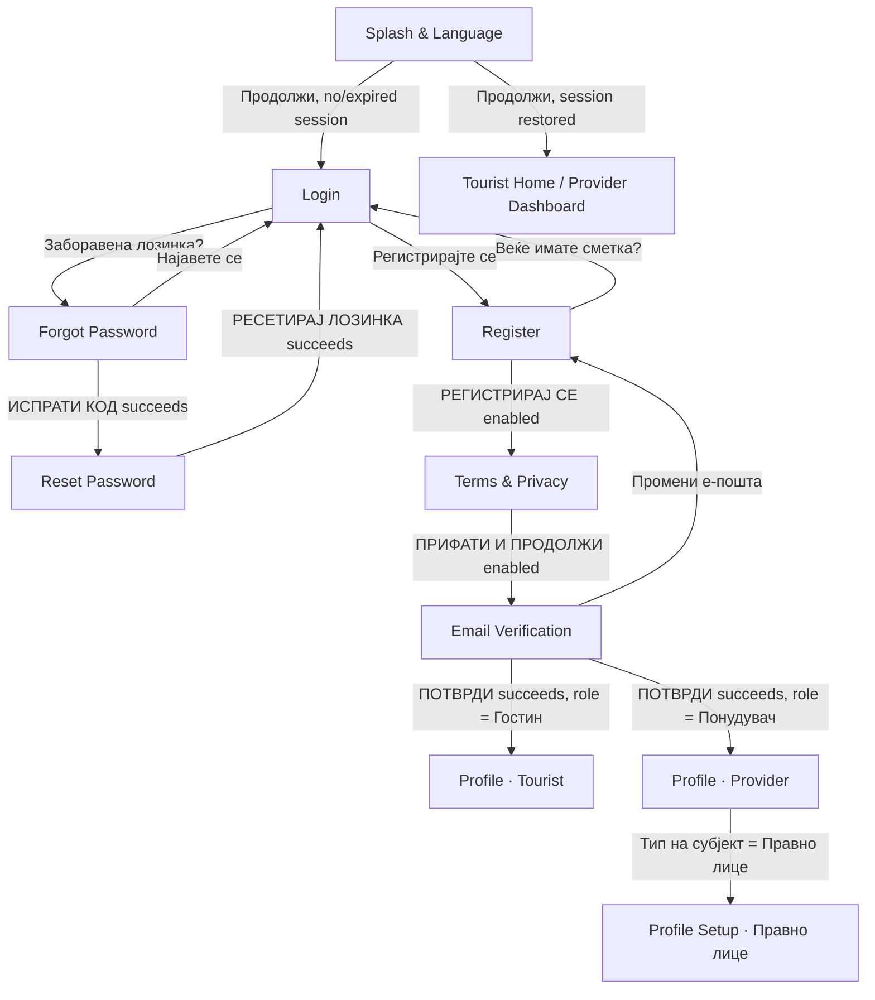
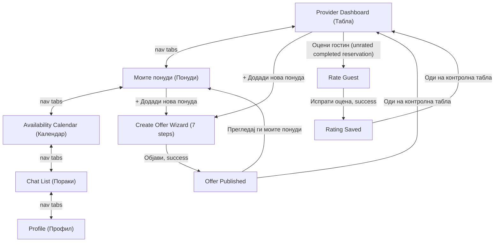
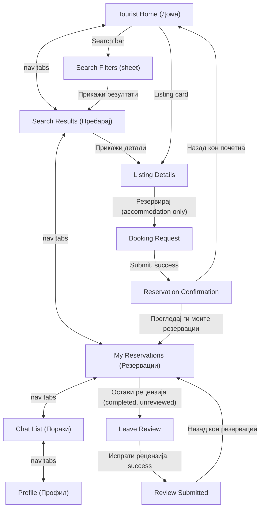
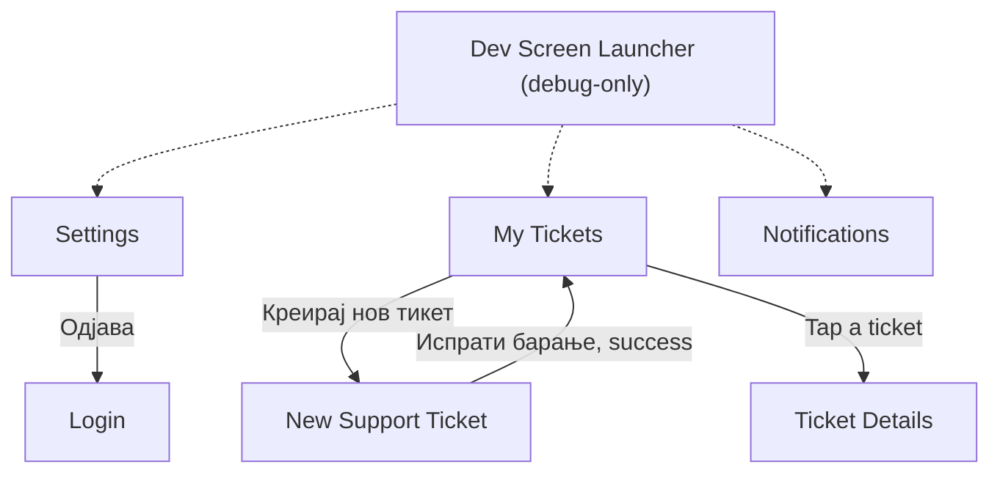

# Bulka — Project Progress

_Rural tourism app for Macedonia (Flutter). This page summarizes what has been built so far, how it's structured, and what's still open. Copy/paste this into the GitHub Wiki (e.g. as `Home` or `Project-Progress`) once you push the code._

## Where we left off

**Latest (2026-11-09): Chat reads from the backend.** The chat list loads `GET /api/chat/conversations` (also feeding the Messages badge) and each thread loads its newest 20 messages from `GET /api/chat/conversations/{id}`. Sending, marking read and older messages are still to do. Full detail in "Chat (backend)" below.

**Before that (2026-11-08):** support tickets (list + new Ticket Details screen) and notifications (list, unread count, mark read, mark all read) moved to the backend. Creating a ticket and deleting a notification are still to do. See "Support Tickets (backend)" and "Notifications (backend)".

_The rest of this section is from the earlier auth round:_

Last worked on: **the start of real backend integration** — the app now makes real HTTP calls against the hosted API instead of every action being local-only state. Login, registration (Buyer + Provider), `GET /api/users/me`, and logout are wired for real; the Tourist/Buyer and Provider flows from the previous round are otherwise untouched. Short-point summary below (see "Backend / Auth Integration" section for full detail); next up, whenever we pick this back up:

- **Real Buyer and Provider logins both now route correctly.** Confirmed role strings: `"Admin"` (no destination), `"Buyer"`, and `"Provider"`. **Critical, confirmed live:** a real Provider account's `roles` was `["Buyer", "Provider"]`, not just `["Provider"]` — a Provider account is apparently also a Buyer. `mapBackendRoleToUserRole` (`lib/models/backend_role_mapper.dart`) checks for `"Provider"` first via `List.contains` specifically because of this — an iterate-and-return-on-first-match approach would have routed every real Provider account to Tourist Home instead of the Provider Dashboard, since `"Buyer"` is listed first.
- **Session now restores on app restart.** `SplashScreen` kicks off `SessionController.restoreSession()` in the background (`initState`) and awaits it when "Продолжи" is tapped — a stored token that still works routes straight to Tourist Home/Provider Dashboard; anything else (nothing stored, or the stored token no longer works) falls through to Login exactly as before.
- **Token refresh and 401 handling are both fully real now.** `ApiClient` has a `QueuedInterceptor` that reacts to any 401 by calling `SessionController.attemptTokenRefresh`, which calls the now-confirmed `POST /api/auth/refresh` and, on success, retries the original request transparently with the new token. **Confirmed live: the backend rotates the refresh token on every use** — the response hands back a brand-new `refreshToken` that must overwrite the old one, which this does via the same `_applyAuthenticatedSession` tail end `login` uses. On any failure (no stored refresh token, or the backend call itself fails), it forces a clean local logout instead of leaving the app believing it's still authenticated.
- **Flutter Web is blocked against the real hosted backend by CORS** (no `Access-Control-Allow-Origin` on the backend's preflight response) — all backend-integration testing has to happen on Android or Windows desktop, not Chrome/web, until the backend owner adds a CORS policy.
- Carried over, unchanged from the Tourist/Buyer round: Map View is still the biggest unfinished *product* piece (see "Known gaps"), rejected/cancelled reservations still aren't shown on My Reservations, no Reservation Details screen, Settings/Notifications/My Tickets still have no real nav entry point, and the 2 Provider Offers `TODO` actions are still blocked on an Edit Listing screen.
- Everything below this point reflects the actual current state of the code, not just intentions — cross-check `lib/` if anything here looks stale.

## Status at a glance

| Screen | Status | Notes |
|---|---|---|
| Splash & Language | ✅ Implemented, **real backend call** | Vertically responsive on short devices; "Продолжи" now attempts `SessionController.restoreSession()` first and routes straight to Tourist Home/Provider Dashboard on a still-valid stored session, falling back to Login otherwise |
| Login | ✅ Implemented, **real backend auth** | `POST /api/auth/login` for real; role-based routing exists but can't reach Buyer/Provider yet (see "Where we left off"); Google sign-in button still UI-only |
| Forgot Password | ✅ Implemented, **real backend call** | "Send code" calls `POST /api/auth/forgot-password` for real, then opens the new Reset Password screen |
| Reset Password | ✅ Implemented, **real backend call**, **not a Figma screen** | Code + new password calls `POST /api/auth/reset-password` for real; built from existing app primitives like `BookingRequestScreen` since no Figma frame defines this step |
| Register | ✅ Implemented | Submit gated on Terms checkbox; now collects first/last/display name (+ business name for Provider) needed by the real register endpoints |
| Terms & Privacy Acceptance | ✅ Implemented, **real backend call** | Submit gated on all 3 consents; "ПРИФАТИ И ПРОДОЛЖИ" now calls `POST /api/auth/register/buyer` or `.../provider` for real (see "Backend / Auth Integration") |
| Email Verification | ✅ Implemented, **real backend calls** | Now has a real code-entry field + "ПОТВРДИ" calling `POST /api/auth/verify-email` for real; "Resend" now calls `POST /api/auth/resend-email-verification` for real too. Temporary dev button removed. |
| Profile (Tourist) | ✅ Implemented | Pre-filled from registration data; Save gated on an actual edit; now hosts `TouristBottomNav` (`selectedIndex: 4`) |
| Profile (Provider · Физичко лице) | ✅ Implemented | Active Offers/Average Rating stat cards now derive from real listing + review data |
| Profile Setup (Provider · Правно лице) | ✅ Implemented | Full alternate screen (logo upload, business fields) shown when the subject-type toggle is set to "Правно лице" |
| Bottom Nav — Tourist / Provider | ✅ Implemented | **Both** roles fully wired now — `TouristBottomNav` centrally resolves all 5 tabs (Дома/Пребарај/Резервации/Пораки/Профил), mirroring `ProviderBottomNav`'s pattern |
| Tourist · Home (Дома) | ✅ Implemented | Search bar → Search Filters sheet; recommended listings from active `ProviderListing`s; category chips still `TODO` |
| Tourist · Search Filters (sheet) | ✅ Implemented | Keyword/location/price range/dates/rating/**guest count**/categories/amenities — one `ListingSearchFilter`, live result count |
| Tourist · Search Results | ✅ Implemented | List view only; quick-filter row; "Карта" button is `TODO` (see Map View below) |
| Tourist · Map View | ❌ Not started | Blocked on a real map-package + coordinates decision — see "Known gaps" |
| Tourist · Listing Details | ✅ Implemented | Gallery, favorites, host row, description, amenities, location placeholder, reviews, booking footer (accommodation-only) |
| Tourist · Booking Request | ✅ Implemented | **Not a Figma screen** — built from existing app primitives since no current-design frame defines this step |
| Tourist · Reservation Confirmation | ✅ Implemented | Always shows "request sent" wording — reservation starts `pending`, not auto-confirmed |
| Tourist · My Reservations | ✅ Implemented | Претстојни/Минати toggle; rejected/cancelled reservations intentionally not shown yet |
| Tourist · Leave Review | ✅ Implemented | Only reachable from a completed, not-yet-reviewed reservation |
| Tourist · Review Submitted | ✅ Implemented | "Назад кон резервации" → My Reservations, Минати tab |
| Provider Dashboard | ✅ Implemented | Hosts `ProviderBottomNav`; "Оцени гостин" now opens the real Rate Guest flow |
| Provider · Моите понуди (Offers) | ✅ Implemented | Listing photos now render correctly; 2 of its per-card actions are `TODO` (need an Edit Listing screen) |
| Provider · Availability Calendar | ✅ Implemented | Reachable via nav "Календар" |
| Provider · Create Offer Wizard (7 steps + Review) | ✅ Implemented | Reachable via both "+ Додади нова понуда" buttons (Dashboard, Offers) |
| Provider · Offer Published (Success) | ✅ Implemented | Reached only after a successful publish |
| Provider · Rate Guest | ✅ Implemented | Opened only from a completed reservation's "Оцени гостин" on the Dashboard |
| Provider · Rating Saved (Success) | ✅ Implemented | Reached only after a successful rating submit |
| Settings | ✅ Implemented | No screen navigates here yet; "Одjава" really logs out to Login |
| Notifications | ✅ Implemented, **real backend call** | Loads the list and unread count; tapping marks read on the backend. No screen navigates here yet |
| Messages · Chat List | ✅ Implemented, **real backend call** (`GET /api/chat/conversations`) | Reachable via "Пораки" on both the Tourist and Provider bottom nav; no bottom nav of its own (see "Confusing" section) |
| Messages · Chat Thread | ✅ Implemented, **real backend call** (`GET /api/chat/conversations/{id}`) | Reachable from Chat List only. Shows the newest 20 messages; sending and marking read are still local only |
| Support · My Tickets | ✅ Implemented, **real backend call** | Loads `GET /api/me/tickets`; tapping a ticket opens Ticket Details. No screen navigates here yet, so it's reachable via the Dev Launcher only |
| Support · New Ticket | ✅ Implemented, 🟡 **local only** | Reachable from My Tickets only. Submitting adds the ticket on this device only; `POST /api/me/tickets` isn't connected yet |
| Support · Ticket Details | ✅ Implemented, **real backend call**, **not a Figma screen** | Loads `GET /api/me/tickets/{id}`. Shows number, status, dates, category, title, description and attachments. Built from the My Tickets card and the New Ticket field styles |
| Dev Screen Launcher | ✅ Implemented (debug-only) | Boots automatically in debug builds; never present in release |
| Choose Role | ❌ Not started | No Figma frame implemented yet |
| Edit Listing screen | ❌ Not started | Blocks 2 Offers-screen actions |
| Reservation Details screen | ❌ Not started | Blocks 1 My Reservations action ("Прегледај детали") |
| Real Map View / coordinates | ❌ Not started | Needs a package + `ProviderListing` lat/lng decision — see "Known gaps" |
| Backend / API integration | 🟡 Started — auth only | Login, Buyer/Provider registration, `GET /api/users/me`, and logout call the real hosted API (`https://agro.finki.net.mk`); every other screen/feature is still local UI state only |

All screens above were built directly from the team's Figma file ("Rural Tourism"), matched frame-by-frame — colors, typography, spacing, and assets pulled from Figma via MCP rather than eyeballed.

## Navigation flow implemented so far

The original registration flow is unchanged and still the only "start to finish" wired path for a brand new user:



**The Provider role has a real, fully-connected shell**, all through `ProviderBottomNav` (every tap either switches tabs in place or `pushReplacement`s to the target screen — never a silent stacked push):



Note this diagram is a simplification — Dashboard/Offers/Calendar/Chat/Profile don't literally form a ring; every nav tap resolves independently to whichever of those 5 screens was tapped, from whichever one you're currently on. See "Provider Create Offer Wizard" and "Provider Rate Guest" below for exactly how exiting/cancelling and publishing/submitting manage the navigation stack, which is more involved than a simple push/pop.

**The Tourist role now has an equally real, fully-connected shell**, through `TouristBottomNav` (same "resolve centrally, guard against re-pushing the tab you're already on" pattern as `ProviderBottomNav`):



Same simplification note as the Provider diagram — the 5-tab ring is really "every tab resolves independently from wherever you are," not a literal cycle. `ListingDetailsScreen`/`BookingRequestScreen` carry an `originTabIndex` (0 from Home, 1 from Search Results) so the navbar highlights the section the user actually came from instead of hardcoding "Дома" — only `ReservationConfirmationScreen` onward switches to "Резервации", once a reservation genuinely exists. **Map View has no entry point yet** — Search Results' "Карта" button is a `TODO`.

**A third, separate cluster of screens still has no entry point from either flow above:**



Solid arrows are real, working `Navigator` transitions. Dashed arrows exist only in debug builds — in a release build there is currently **no way to reach Settings, My Tickets, New Ticket, or Notifications at all**.

**Data flow.** The name/email/phone entered on Register are carried forward via a small `RegistrationProfile` model passed as a constructor parameter screen-to-screen — no state-management library, just plain data passed down.

**Shared feature state** (Notifications, Chat, Support tickets, Provider listings, Reservations, Availability, Guest ratings, and now **Listing Reviews, Favorites, and Search**) all use the same pattern: a `ChangeNotifier` singleton per feature under `lib/services/`, listened to via manual `addListener`+`setState`. Any screen or widget can read the same singleton — this is what lets, for example, accepting a reservation on the Dashboard, publishing a new listing from the wizard, submitting a guest rating, or **a Tourist submitting a listing review, be visible everywhere that depends on it immediately** (Listing Details, Search Results, Provider Offers, Provider Profile's average rating, and the rating search filter all update live off the exact same `ListingReviewController`) with zero manual cross-screen sync.

**The Create Offer wizard uses a different, narrower pattern on purpose**: its `CreateListingDraft` is a plain **mutable object scoped to one wizard session** (owned by the wizard screen's own `State`, not a singleton) — see the wizard's own notes below for why. **The Search Filters sheet follows the same narrower pattern**: `ListingSearchFilter` is a mutable draft edited by one sheet session, only becoming the shared `SearchController.instance.filter` once "Прикажи резултати" is pressed.

## Screen-by-screen notes

**Splash & Language** (`lib/screens/splash_screen/`)
Solid green background, logo, title/subtitle, language switch (MK/SQ/EN), CTA. Vertically responsive (Galaxy S8+ / 360×740 tested). Covered by `test/splash_screen_responsive_test.dart`.

**Login / Forgot Password / Register / Terms & Privacy / Email Verification**
**This round**: Login, Register, Terms & Privacy, Email Verification (verify + resend), and now Forgot/Reset Password all make real backend calls — see "Backend / Auth Integration" below for the full detail. Register's role toggle still drives which Profile screen Email Verification routes to after a real successful verify.

**Profile · Tourist** (`lib/screens/profile_screen/`)
Pre-filled from `RegistrationProfile`; Save disabled until an actual edit is made; Reservations/Favorite Places hardcoded at 0 (no such system exists yet). **This round**: gained `bottomNavigationBar: TouristBottomNav(selectedIndex: 4)` — it previously had none at all and was a dead end reachable only via the Dev Launcher.

**Profile · Provider (Физичко лице) / Profile Setup · Provider (Правно лице)** (`lib/screens/provider_profile_screen/`, one file)
Selecting "Правно лице" swaps the **entire** screen body (own header, logo upload, company fields, business details, additional contacts, real multi-photo picker) rather than just the personal-data fields. **Bugfix this round**: the "Активни понуди"/"Просечна оценка" stat cards were still `static const` hardcoded to `0` from before `ProviderListingController` existed — they're now derived getters (`ProviderListingController.instance.activeListingsCount`, and an average of active listings' own `rating` values), and the screen listens to the controller so both update live as listing statuses change elsewhere (e.g. a wizard-published listing getting approved, or an archived one being reactivated).

**Bottom Nav — Tourist / Provider** (`lib/widgets/bottom_nav_bar.dart`, `lib/widgets/app_bottom_nav.dart`)
**This round**: `TouristBottomNav` now resolves all 5 tabs centrally (Дома/Пребарај/Резервации/Пораки/Профил), exact same switch-and-guard-against-duplicate-push shape `ProviderBottomNav` already used — previously only "Пораки" worked and the other 4 taps were silent no-ops on every Tourist screen. `ProviderBottomNav` itself is untouched.

## Tourist / Buyer flow (this round)

Short points — see the code/commit history for full detail; every screen below is real, wired, and reading from shared state, not mocked in place.

- **`TouristHomeScreen`** (`lib/screens/tourist_home_screen/`) — recommended listings from `ProviderListingController.recommendedListings` (active only); search bar opens the Search Filters sheet; category chips still `TODO` (no destination screen for them yet).
- **Search Filters sheet** (`lib/screens/tourist_home_screen/search_filters_sheet.dart`) — one `ListingSearchFilter` model (keyword, location, price range, dates, rating, **guest count** — added this round alongside rating, not instead of it —, categories, amenities). Edits a local copy; only becomes the shared filter on "Прикажи резултати", which shows a **live** result count computed the same way the results screen itself filters.
- **`SearchController`** (`lib/services/search_controller.dart`) — the one shared "current search" singleton (filter + derived `matchingListings`), so Search Results and Map View (once built) always see the same result set without either screen owning its own copy.
- **`SearchResultsScreen`** (`lib/screens/search_results_screen/`) — list view of `SearchController`'s current matches; quick-filter row (category/rating chips + "Филтри"/"Цена" reopen the full sheet); "Карта" is a styled `TODO`.
- **`ListingDetailsScreen`** (`lib/screens/listing_details_screen/`) — photo gallery (swipeable, real `photoPaths`), favorite toggle (`FavoritesController`, local-only), host row, description, amenities (only what's actually set), location (map still a placeholder), reviews section (`ListingReviewController`), and a booking footer **gated to accommodation-category listings only** (`categoryRequiresPrice`) — other categories show the button dimmed/inert rather than a fake nights-based booking flow.
- **`BookingRequestScreen`** (`lib/screens/booking_request_screen/`) — **not a Figma screen.** No current-design frame defines a date/guest-count input step, so this reuses existing primitives instead of inventing new visual language: the same `showDateRangePicker` the filter sheet uses, plus a capacity stepper matching the Create Offer wizard's own guest-count row. Validates the picked range day-by-day against `AvailabilityController` (reused, not duplicated) before allowing submit.
- **`ReservationController.createReservation(...)`** — the one place a Tourist booking becomes a real `Reservation`: always starts **`pending`** (goes through the same Provider accept/reject queue every other reservation already does — this intentionally does *not* match Figma's literal "Резервацијата е потврдена!" wording, since that would misrepresent an unapproved booking as confirmed). Generates a local `bookingReference` (`RB-XXXXX`, collision-checked, `TODO`'d for a backend-issued one later) and snapshots `nightlyPriceAtBooking`/`serviceFee`/`totalAmount` at booking time so a later Provider price edit can never retroactively change an old reservation's total. `Reservation` also gained an optional `listingId` (backfilled onto existing mock reservations) — real relationship, not name-matching.
- **`ReservationConfirmationScreen`** (`lib/screens/reservation_confirmation_screen/`) — shows the just-created reservation's real data; wording says "request sent", matching the real `pending` status.
- **`TouristMyReservationsScreen`** (`lib/screens/tourist_my_reservations_screen/`) — Претстојни (`pending`+`accepted`) / Минати (`completed`) toggle, one shared `ReservationController` as the source, filtered to the current mock Tourist identity (`mockTouristGuestName`, see "Known gaps"). **`rejected`/`cancelled` reservations are intentionally shown in neither tab** — flagged, not silently dropped.
- **`LeaveReviewScreen` / `ReviewSubmittedScreen`** (`lib/screens/leave_review_screen/`, `lib/screens/review_submitted_screen/`) — reachable only from a completed, not-yet-reviewed reservation; already-reviewed reservations show the action dimmed/inert (reusing the same pattern as Listing Details' non-bookable categories) rather than a new invented "already reviewed" badge. Submits through `ListingReviewController.submitReview(...)`, which independently re-validates eligibility + no-duplicate regardless of what the UI already checked (same idiom as `GuestRatingController.submitRating`).
- **`ListingReviewController.effectiveRating(listing)`** — **the one authoritative rating calculation app-wide.** Real average of a listing's actual `ListingReview`s when any exist; falls back to the old stored `ProviderListing.rating` only for listings with zero reviews. **Every screen that shows a rating** (Listing Details, Search Results, Provider Offers, Provider Profile's average, and the search filter's rating threshold) now calls this instead of reading `listing.rating` directly — `ProviderListing.rating` itself is unchanged/still stored, just demoted to "fallback only."

**Provider Dashboard** (`lib/screens/provider_dashboard_screen/`)
"Контролна табла" — greeting derived from the provider's first listing's title, 3 counters derived from `ProviderListingController`/`ReservationController`, a "Резервации кои чекаат" section with working Прифати/Одбиј, and a "Завршени резервации" section. **"Оцени гостин" is now fully wired**: `_handleRateGuest(reservation)` checks `GuestRatingController.hasRating(reservation.id)` first — if already rated, it does nothing (no re-entry, no duplicate); otherwise it pushes `RateGuestScreen` with that exact `Reservation` object (no separate mock guest data — `guestName`/`listingName`/dates all come straight from the reservation already in hand). Hosts `ProviderBottomNav` at `selectedIndex: 0`.

**Provider · Моите понуди (Offers)** (`lib/screens/provider_offers_screen/`)
Renders entirely from `ProviderListingController.filteredListings(status: ...)`. 4 filter chips (Сите/Активни/На преглед/Одбиени, matching Figma exactly — archived listings show under "Сите" with no dedicated chip). Status pill/message/action per card driven by `ListingStatus`, never scattered strings. **Bugfix this round**: each card's image area was unconditionally rendering the flat placeholder color, even for listings with real picked photos (e.g. ones published via the Create Offer wizard) — it now renders `listing.photoPaths.first` via the shared `XFileImage` widget when present, falling back to the placeholder only for listings that genuinely have none. Only "Активирај повторно" is wired for real; "Уреди"/"Уреди и поднеси повторно" remain `TODO`s pending an Edit Listing screen.

**Provider · Availability Calendar** (`lib/screens/provider_availability_calendar_screen/`)
Unchanged since the last update — real `DateTime`-driven month calendar, `AvailabilityStatus` derived per-day (`occupied` always computed from `ReservationController`, `blocked` is the only real stored state), multi-select `Set<DateTime>` UI state kept separate from availability itself.

**Provider · Create Offer Wizard** (`lib/screens/create_offer_wizard_screen/`)
Unchanged since the last update — one route/one `StatefulWidget`, `_currentStep` swaps content, one shared mutable `CreateListingDraft`. See the previous revision of this doc (or the code itself) for the full step-by-step breakdown; the short version: 7 Figma steps + Review, per-step validation, a centralized `categoryRequiresPrice` rule, exit/cancel via a discard-confirmation dialog only when the draft has real content, and `ProviderListingController.createListing(draft)` on publish (always `status: pendingReview`).

**Provider · Offer Published (Success)** (`lib/screens/create_offer_success_screen/`)
Unchanged since the last update. Reached only via `pushReplacement`; both actions clear the entire stack down to one target screen via `pushAndRemoveUntil`.

**Provider · Rate Guest** (`lib/screens/rate_guest_screen/`) — new this round
Rates the guest of one specific `completed` `Reservation`, passed in directly (not looked up by id) from the Dashboard. Guest row shows a derived avatar (initials computed from `reservation.guestName`, same pattern used elsewhere in the app), name, and a listing+date-range+year context line (the year is a one-off composition local to this screen — no other screen using the shared `formatMkDateRange` shows one, so the shared formatter itself wasn't changed). A 5-star control (`agroGold100` filled / `agroBorder300` empty — exact Figma colors) drives a single `int _rating` (0 = unselected), plus an optional multi-line note. "Испрати оцена" is disabled until `_rating >= 1`. Submitting calls `GuestRatingController.submitRating(reservation:, rating:, note:)`, which independently re-validates both eligibility (`status == completed`) and no-duplicates regardless of what the UI already checked, then `pushReplacement`s to the Rating Saved screen.

**Provider · Rating Saved (Success)** (`lib/screens/rating_saved_screen/`) — new this round
Visually and structurally mirrors `CreateOfferSuccessScreen` (same check-circle/heading tokens, different top padding, only one action button instead of two). "Оди на контролна табла" does `pushAndRemoveUntil` to a fresh `ProviderDashboardScreen`, same pattern as the offer-published flow — Back can never return to a submitted rating form.

**Settings / Notifications / Messages / Support**
Unchanged since the last update.

**Dev Screen Launcher** (`lib/dev/dev_launcher_screen.dart`) — debug-only, not a Figma screen
Grew substantially this round — every new Tourist screen has its own entry (Home, Search Filters sheet standalone, Search Results, Listing Details, Booking Request, Reservation Confirmation, My Reservations, Leave Review, Review Submitted), several seeding real mock data on tap (e.g. creating a real `pending`/`completed` reservation) so the screen isn't empty when opened in isolation. Still wired the same way, zero effect on release builds.

## Backend / Auth Integration (this round)

The API contract is `backend/swagger.json` (gitignored — kept locally, not in the repo), fetched from the hosted **AgroEco Mobile API**. It documents **request schemas only** — no response schemas, no status codes beyond 200, and no role enum anywhere — so every response shape below was confirmed against the real live backend (`https://agro.finki.net.mk`) before being typed, never guessed from the spec alone.

- **Login** (`POST /api/auth/login`) — real request/response, confirmed live. Requires header `X-Client-Type: mobile`; response is `{ success, data: { accessToken, accessTokenExpiresAtUtc, refreshToken, user, twoFactorChallenge, webSession }, errors, traceId }`. `user` matches `AuthUser` exactly. 2FA (`twoFactorChallenge` non-null) is detected and treated as "login not completed" rather than crashing, but isn't implemented — out of scope so far. A failed login due to an unverified email is also confirmed live: 403, `errors: [{ code: "AUTH_EMAIL_NOT_VERIFIED", message: "Email is not verified." }]` — `LoginScreen` detects that specific code (`SessionController.emailNotVerified`) and redirects straight to `EmailVerificationScreen` instead of just showing the message inline. A real **Buyer** login is now confirmed too: `roles: ["Buyer"]`, `emailVerified: true`, plus `phone`/`phoneCompletionRequired`/`providerQuestionnaireRequired` on `user` that weren't visible on the Admin account — a real Buyer login now routes all the way to Tourist Home for the first time. The curl used to get this included a `rememberMe` field in the request body, but it isn't part of `LoginRequest`'s documented schema (`additionalProperties: false`), so it was left out rather than added on a guess.
- **Registration** (`POST /api/auth/register/buyer` / `.../provider`) — real request and response, both confirmed live via a real Swagger UI call. `TermsPrivacyScreen` is where the call actually fires (the first point terms/privacy consent exists). Buyer's `data` decodes into `RegisterResult` (`{ userId, status, emailVerificationRequired }`); Provider's decodes into the separate `ProviderRegisterResult` (`{ userId, providerProfileId, userStatus, providerProfileStatus, emailVerificationRequired }`) — deliberately not shared with Buyer's model since the status field is named differently (`status` vs. `userStatus`). Both observed responses mean "go verify your email next" (`status`/`userStatus: "PendingVerification"`, `emailVerificationRequired: true`), so both branches proceed straight to Email Verification — no token/session is established by registration itself, and no raw-response debug dialog remains.
- **Email verification** (`POST /api/auth/verify-email`, `POST /api/auth/resend-email-verification`) — real requests; `resend`'s response is fully confirmed live (`{ sent: true }`, decodes into `ResendEmailVerificationResult`). `verify`'s *failure* envelope is confirmed live (400, `{ code: "AUTH_EMAIL_VERIFICATION_INVALID", message: "Invalid verification code." }`), but its *success* `data` hasn't actually been observed yet (no real code tried) — `AuthRepository.verifyEmail` deliberately leaves it untyped, same as `registerProvider` before its response was confirmed; the UI only needs success/failure, not any field inside `data`. `EmailVerificationScreen` now has a real code-entry field wired to `verifyEmail` and a real "Resend" button wired to `resendEmailVerification`; the old "Продолжи (привремено)" stand-in button is gone.
- **Forgot/reset password** (`POST /api/auth/forgot-password`, `POST /api/auth/reset-password`) — real requests, neither response confirmed live yet (both untyped in `AuthRepository`, same pattern as `verifyEmail`'s unconfirmed success case — the UI only needs success/failure). `ForgotPasswordScreen`'s "Send code" now calls `forgotPassword` for real and opens the new `ResetPasswordScreen` (code + new password + confirm, client-side-only match check) on success, which calls `resetPassword` and returns to Login. `ResetPasswordScreen` is **not a Figma screen** — built from existing app primitives (same composition as `ForgotPasswordScreen`) since no frame defines this step; reconcile against a real frame if one ever gets designed.
- **Token refresh** (`POST /api/auth/refresh`) — real request and response, both confirmed live. Response decodes into `LoginResponseData` directly — it's exactly the same shape as login's. **Confirmed live: the backend rotates the refresh token on every use** (the response's `refreshToken` was a different value from the one sent in the request), so `AuthRepository.refreshToken`/`SessionController.attemptTokenRefresh` were deliberately left as a no-op until this was confirmed — calling it without being able to persist the new refresh token would have silently broken the session for real. `SessionController.attemptTokenRefresh` is registered with `ApiClient` as its 401 handler (a `QueuedInterceptor`, so a burst of concurrent 401s triggers exactly one refresh attempt) and now actually refreshes + retries transparently on success, or forces a local logout on any failure. Also powers `restoreSession` for free: a stored access token that's expired by the time the app restarts gets silently refreshed mid-restore rather than forcing a fresh login.
- **Current user** (`GET /api/users/me`) — confirmed live to return exactly the same `AuthUser` shape as login's `user` object; no separate model needed.
- **Logout** (`POST /api/auth/logout`) — takes `{ refreshToken }` (the request body's schema is actually shared with `/api/auth/refresh` in the OpenAPI contract — `RefreshRequest`, not a logout-specific one), no `Authorization` header (the refresh token itself identifies the session). Response is now fully confirmed live too: `{ loggedOut: true }`, decodes into `LogoutResult`. Implemented as **best-effort**: the backend call's success/failure is irrelevant to whether the local session gets cleared — it always does. Wired to Settings' "Одjава", which calls `SessionController.logout()` and disables itself while the call is in flight (to avoid a double-tap firing two concurrent logout calls), then navigates to Login regardless of backend outcome.
- **Base URL**: `ApiEnvironment.baseUrl` defaults to `https://agro.finki.net.mk`, overridable via `--dart-define=API_BASE_URL=...`.
- **Not implemented yet, on purpose**: `/api/auth/invitations/accept` (no UI/entry point anywhere in the app for it), `/api/auth/external/complete` (not even documented in the local `backend/swagger.json` — may need a fresh pull from the live Swagger UI; also blocked on the still-UI-only Google sign-in button, which needs real OAuth SDK integration).

## Support Tickets (backend)

All in `SupportTicketsBloc` (`lib/blocs/support_tickets/`); the mock ticket data is deleted.

**Implemented:**
- **List** (`GET /api/me/tickets`), confirmed live. `SupportTicketsRequested` is sent each time My Tickets opens. The state has a `status` (initial/loading/loaded/failed) and My Tickets shows a spinner, "Couldn't load your tickets" with "Try again", or "You don't have any tickets yet". A reload drops the old list straight away (it may belong to a previous account), and a late response from an older request is ignored. Newest ticket first.
- **Details** (`GET /api/me/tickets/{id}`), response confirmed live. `SupportTicketDetailsRequested(id)` is sent each time Ticket Details opens; results are kept per id (`detailsFor(id)`, `detailsStatusFor(id)`). The ticket from the list shows straight away while the details load, and a failed reload keeps what's shown. A 404 shows the Not Found screen. Tickets created on this device aren't requested (the backend doesn't know them).
- **Ticket Details screen** (`lib/screens/ticket_details_screen/`, route `/tickets/:ticketId`, `AppRoutes.ticket(id)`). **Not a Figma screen**: the summary card matches the My Tickets card (number, status pill, title, created date, last updated), and category/title/description are read-only boxes styled like the New Ticket fields. Image attachments show as a preview, other files as a file-name row; the section is hidden when there are none.
- **`SupportTicket` model**: `fromJson`, the backend's `ticketNumber` as `number`, a new `closed` status (`TicketStatus.fromApi` maps `Open`/`InProgress`/`Resolved`/`Closed`), and `attachments` is now a list. The response has no "last changed" time, so `updatedAt` is the latest of created, closed and message times. `categoryLabel` translates the backend type (`Booking` → Reservations, `Listing`, `Payment`, `Account`/`Profile`, `Other`).
- **`SupportAttachment`**: gained `url` and `fromJson`; `localPath` is now optional (empty for a backend file).
- New strings in all 3 languages: `ticketStatusClosed`, `ticketsLoadFailed`, `ticketsEmpty`, `ticketDetailsTitle`, `ticketDetailsLoadFailed`, `ticketCreatedLabel`, `ticketAttachmentLabel`.
- Dev Launcher entry "Ticket Details" (opens the first ticket, creating a local one if the list is empty), so the all-languages overflow test covers it. Bloc tests in `test/blocs_test.dart` cover list loading, parsing, failures, details, 404, failed reload, and local tickets.

**Still to do:**
- **Create a ticket on the backend (`POST /api/me/tickets`).** Body: `type`, `priority`, `subject`, `description`, optional `linkedBookingId`/`linkedListingId`/`linkedPaymentTransactionId`/`linkedReviewId`/`linkedConversationId`, `attachmentMediaAssetIds`, `turnstileToken`. A Swagger test returned 404 `MEDIA_NOT_FOUND` only because it sent Swagger's placeholder GUID; it needs to be retried with the linked ids `null` and `attachmentMediaAssetIds: []`. Open questions:
  - The allowed `type` and `priority` values. Seen so far: types `Booking`, `Payment`, `Technical`, `Other`; priorities `High`, `Normal`. New Ticket's categories (Reservations/Listings/Payment/Profile/Other) need mapping to real types, and the form has no priority field.
  - Whether `turnstileToken` is checked (auth sends an empty string today).
  - Attachments need an upload endpoint that returns a media asset id first; none found yet.
  - Until this is done, a ticket created in the app disappears the next time My Tickets loads.
- **Attachment JSON shape is a guess.** No ticket with an attachment has been seen yet; `SupportAttachment.fromJson` reads `publicUrl`/`url`, `originalFileName`/`fileName`, `contentType`/`mimeType`, `sizeBytes`/`fileSizeBytes`. Check it against a real response.
- **Unknown ticket types show as the raw English word** (e.g. `Technical`) until the full list of types is known.
- **Not shown on Ticket Details:** the `messages` thread (replies from support), priority, assigned moderator and resolution note. A message thread with a reply box is the natural next step (needs the send-message endpoint).
- **No real entry point to My Tickets** — still Dev Launcher only (same as Settings/Notifications).
- Not yet tested on a device against the real backend (Android/Windows; web is blocked by CORS).

## Notifications (backend)

In `NotificationsBloc` (`lib/blocs/notifications/`); the mock data is deleted.

**Implemented:**
- `GET /api/me/notifications`, response confirmed live. `NotificationsRequested` is sent each time Notifications opens; the state has a `status` (initial/loading/loaded/failed), and the screen shows a spinner, "Couldn't load your notifications" with "Try again", or "You don't have any notifications". Newest first; a reload drops the old list (may belong to a previous account) and late responses from older requests are ignored.
- `NotificationItem.fromJson`: `body` → `message`, `createdAtUtc` → `timestamp`, read = `readAtUtc` is set. Also keeps `type` and `linkUrl`. Notifications with `dismissedAtUtc` set are left out.
- **Unread count** — `GET /api/me/notifications/unread-count`, response confirmed live (`data: { count }`). `UnreadNotificationsCountRequested` is sent right after the list each time Notifications opens, and the "N unread notifications" subtitle uses it (`serverUnreadCount`). If it fails, the subtitle counts the unread ones in the loaded list instead. Reading a notification lowers it by one, and a list reload clears it (may belong to a previous account).
- **Mark as read** — `POST /api/me/notifications/{id}/read` (id in the path, no body), response confirmed live: the updated notification with `readAtUtc` set. Tapping an unread notification shows it read straight away, then sends the request; on success the backend's copy replaces it, on failure it shows as unread again (and the count goes back up). Already-read notifications aren't sent again.
- **Mark all as read** — `POST /api/me/notifications/read-all` (no parameters, no body), response confirmed live: `data: { count }`, how many it marked (not needed by the app). A "Mark all as read" text link sits above the list while any notification is unread — **not in the Figma design**, styled like the app's other text links. It shows everything read straight away; on failure the ones that were unread show as unread again and the count is restored. New string `notificationsMarkAllRead` in all 3 languages.
- Strings `notificationsLoadFailed` and `notificationsEmpty` in all 3 languages; bloc tests in `test/blocs_test.dart`.

**Still to do** (all listed in `backend/swagger.json`, responses not seen yet):
- **Dismiss / delete** — `DELETE /api/me/notifications/{id}` (id in the path, no body; the spec has no description or response shape). **Waiting on test data:** the test account has only one notification, and the backend team has been asked to add more so this can be tried without losing it. To find out what it does: note an id from `GET /api/me/notifications`, call the DELETE and save its response, then list again. If the notification is still there with `dismissedAtUtc` set, it's a dismiss (likely — the app already hides dismissed ones); if it's gone, it's a real delete. Also compare `GET .../unread-count` before/after when deleting an unread one. Planned UI: swipe a card to dismiss it, shown gone straight away and put back if the request fails (same pattern as mark as read).
- **Unread badge** — the count is loaded, but only the Notifications screen uses it. No bell icon with a badge exists anywhere in the app yet (it would also be the missing entry point to Notifications).
- **Opening `linkUrl`** — it's a web path (e.g. `/bookings/{id}`); tapping should open the matching app screen (needs a Reservation Details screen for bookings).
- No real entry point to Notifications — still Dev Launcher only.
- Not yet tested on a device against the real backend.

## Chat (backend)

In `ChatBloc` (`lib/blocs/chat/`); the mock conversations are deleted.

**Implemented:**
- **Conversation list** — `GET /api/chat/conversations` (no parameters; both roles), response confirmed live. `ChatConversationsRequested` is sent when the Tourist/Provider tabs open (so the Messages badge has a count) and each time the chat list opens. The state has a `status` (initial/loading/loaded/failed); the chat list shows a spinner, "Couldn't load your messages" with "Try again", or "You don't have any conversations yet". Newest message first; a reload drops the old list (may belong to a previous account) and late responses from older requests are ignored.
- **`ChatConversation` model** rebuilt around the response: buyer/provider names, `buyerUserId`, `title` (shown under the name), `status` (`Open`/`Closed`/`Blocked`), `startedAtUtc`, `lastMessageBody`/`lastMessageAtUtc` (the row's preview and time) and the backend's `unreadCount` (the row badge and the nav badge). The name shown is the other person's: `participantNameFor(myUserId)` gives the Provider's name when the signed-in user is the conversation's Buyer, otherwise the Buyer's. Initials come from that name.
- **Messages** — `GET /api/chat/conversations/{id}`, response confirmed live: the conversation plus `messages: { items, page, pageSize, totalCount, totalPages }`, items newest first (shown oldest first). `ChatConversationDetailsRequested` is sent each time a thread opens; results are kept per conversation (`detailsFor(id)`, `detailsStatusFor(id)`). The header shows straight away from the list while messages load; the thread shows a spinner, "Couldn't load the messages" with "Try again", or "No messages yet", and jumps to the newest message once they arrive. A failed reload keeps the messages shown; a 404 with no list entry shows Not Found.
- **Whose message:** `ChatMessage.isMineFor(myUserId)` compares `senderUserId` with the signed-in user's id (right/green bubble when it matches). Messages with `deletedAtUtc` set show as "This message was deleted" in italics. `senderRole`, `senderDisplayName`, `mediaAssetIds` and the flag fields are read from the response but not used yet.
- Chat Thread opened directly (e.g. `/messages/:id`) loads the list and the messages, and shows a spinner until one of them finds the conversation.
- The live Swagger has an optional `messageId` **query** parameter on this endpoint (the local `backend/swagger.json` is out of date and doesn't show it). It isn't sent; what it does is unknown (probably paging from a given message).
- Strings `chatLoadFailed`, `chatEmpty`, `chatMessagesLoadFailed`, `chatNoMessages` and `chatMessageDeleted` in all 3 languages; bloc tests for the list and the messages; the fake test backend answers `/api/chat/conversations` and `/api/chat/conversations/conv-1`, and the "Chat Thread" dev entry loads the list and opens the first conversation.
- **Test setup fix:** `test/flutter_test_config.dart` now uses `FlutterSecureStorage.setMockInitialValues({})`. Without it, any signed-in request in a widget test waited forever for the keychain, and since the auth interceptor is queued, every request behind it waited too (Home's categories/listings never loaded once the tabs started loading conversations).

**Still to do:**
- **Older messages** — only the first page (20, the newest) is loaded. Conversations with more need paging: find out how (`messageId` query? a `page` parameter?) and load more when scrolling up.
- **Images in messages** — `mediaAssetIds` is always empty so far; needs a media URL endpoint to show them.
- **Refresh `backend/swagger.json`** from the live Swagger — it's missing at least the `messageId` parameter above.
- **Send a message** — `POST /api/chat/conversations/{id}/messages` (has a body; response not seen yet, same for the endpoints below). Sending only adds the message on this device; it's gone after the next load.
- **Mark as read** — `POST /api/chat/conversations/{id}/read` (has a body). Opening a conversation clears its unread count on this device only, so the badge comes back on the next load.
- **Start a conversation** — `POST /api/chat/conversations` (has a body), e.g. "Contact the host" from Listing Details.
- **Delete a message** — `DELETE /api/chat/conversations/{id}/messages/{messageId}`.
- **Closed / Blocked conversations** still show the message input; they probably shouldn't allow sending (check what the backend does).
- `bookingContexts` (always empty so far) and `bookingId` aren't used yet — could show the booking a conversation is about.
- Each time the chat list opens the list reloads from scratch, so the nav badge briefly drops to 0 while it loads.
- Not yet tested on a device against the real backend.

## Architecture / design system

**New this round — backend integration (`lib/core/network/`, `lib/services/`, `lib/models/`):**
- **`ApiClient`** (`api_client.dart`) — single shared `Dio` singleton. Holds two interceptors: `_AuthHeaderInterceptor` attaches `Authorization: Bearer <token>` to every call except a hardcoded public-path exclusion list (login, both register endpoints, verify-email, resend-verification, forgot/reset-password, refresh, logout), and `_RefreshOnUnauthorizedInterceptor` (a `QueuedInterceptor`, so a burst of concurrent requests that all 401 at once triggers exactly one refresh attempt, not one per request) reacts to a 401 from any other path by calling a registered refresh handler and either retrying the original request (on success) or letting the 401 through (on anything else). Both interceptors read the token/call the refresh handler via provider callbacks `SessionController` registers on construction, specifically to avoid a `core` → `services` import cycle.
- **`ApiEnvironment`** (`api_environment.dart`) — the one place `baseUrl` is defined.
- **`ApiResponse<T>`** (`api_response.dart`) / **`ApiErrorItem`**/**`ApiException`**/**`ApiExceptionKind`** (`api_exception.dart`) — generic decode of the backend's one confirmed envelope shape (`success`/`data`/`errors`/`traceId`), and the one exception type the rest of the app ever catches for a failed call. `ApiException.hasErrorCode(code)` lets a caller react to one specific confirmed backend error code (e.g. `AUTH_EMAIL_NOT_VERIFIED`) without matching on free-form `message` text.
- **`ApiErrorMapper`** (`api_error_mapper.dart`) — the single place a `DioException` is turned into an `ApiException`; maps HTTP status → `ApiExceptionKind`, prefers the backend's own error message, falls back to a Macedonian `AppStrings` message otherwise (never shows raw Dio text to a user).
- **`TokenStorage`** (`token_storage.dart`) — wraps `flutter_secure_storage`; the only thing that touches it. Stores access token, refresh token, and access-token expiry; never a password.
- **`AuthRepository`** (`lib/services/auth_repository.dart`) — all `/api/auth/*` and `/api/users/me` HTTP calls: `login`, `registerBuyer`, `registerProvider`, `getCurrentUser`, `logout`.
- **`SessionController`** (`lib/services/session_controller.dart`) — `ChangeNotifier` singleton, same pattern as every other controller in the app; the one source of truth for `currentUser`/`isAuthenticated`/`appRole`/`isLoading`/`errorMessage`/`emailNotVerified`. `refreshCurrentUser()` exists but isn't called from anywhere yet. `restoreSession()` is new — called from `SplashScreen` on every app start, it re-populates `currentUser` from a stored token via `GET /api/users/me` without requiring a fresh login. `attemptTokenRefresh()` is new too — registered with `ApiClient` as its 401 handler, it calls the now-confirmed `POST /api/auth/refresh` and applies the (rotated) tokens on success, or forces a local logout on any failure (see "Backend / Auth Integration").
- **`AuthUser`, `LoginRequest`, `LoginResponseData`, `BuyerRegisterRequest`, `ProviderRegisterRequest`, `RegisterResult`, `ProviderRegisterResult`, `ResendEmailVerificationResult`** (`lib/models/`) — request/response models, field names matching the confirmed live JSON exactly. `RegisterResult`/`ProviderRegisterResult` are kept as two separate classes rather than one shared type, since the two confirmed responses name their status field differently (`status` vs. `userStatus`). `AuthUser` now also has `phone`/`phoneCompletionRequired`/`providerQuestionnaireRequired`, confirmed on a real Buyer login; `LoginResponseData` has a `webSession` field too, kept untyped (only ever observed as `null`). `LogoutResult` (`lib/models/`) is new too — logout's response is now fully confirmed and typed, same as everything else here.
- **`mapBackendRoleToUserRole`** (`lib/models/backend_role_mapper.dart`) — the one centralized place a raw backend role string maps to this app's `UserRole`; now maps the confirmed `"Buyer"` to `UserRole.buyer` and `"Admin"` to `null` (no Admin destination exists) — Provider's real role string is still unconfirmed, see "Where we left off".
- **`RegistrationProfile`** extended with `firstName`/`lastName`/`displayName`/`password`/`businessName`, carried from `RegisterScreen` to `TermsPrivacyScreen` only (nothing downstream reads them) — `password` is never logged and is discarded once those two screens are left.

**From the Rate Guest round:**
- **`lib/widgets/xfile_image.dart`** — **`Image.file`/`FileImage` (both backed by `dart:io`) hard-fail on Flutter Web** — the browser has no real filesystem. `XFileImage`/`xfileImageProvider` branch on `kIsWeb`: `Image.network`/`NetworkImage` on web (a picked file's `.path` is a `blob:` URL there), `Image.file`/`FileImage` everywhere else. Used everywhere the app renders a locally-picked image, including every new Tourist card/gallery this round.
- **`GuestRating`/`GuestRatingController`** — Provider rates a guest after a completed reservation. `submitRating` enforces "only completed" + "no duplicates"; safe to call regardless of what the UI already checked.

**From this round (Tourist/Buyer flow) — new models:**
- **`ListingSearchFilter`** (`lib/models/`) — mutable search-filter draft (keyword, location, price range, dates, rating, guest count, categories, amenities). Edited by the Search Filters sheet; committed to `SearchController` on apply.
- **`ListingReview`** (`lib/models/`) — a guest's review of a *listing*, deliberately the opposite direction from `GuestRating` (different author, different subject). Has `reservationId` (nullable — the 2 original mock reviews predate this relationship) as the duplicate-review boundary.
- **`Reservation`** extended with `listingId` (real FK, backfilled onto mock data), `bookingReference`, `nightlyPriceAtBooking`, `serviceFee`, `totalAmount` — a price/reference *snapshot* taken at booking time, deliberately not re-derived from the listing's current price later.

**New services:**
- **`SearchController`** — holds the Tourist's *current* search (filter + derived `matchingListings`), so Search Results/Map View share one result set instead of each owning a copy.
- **`ListingReviewController`** — `reviewsForListing`, `hasReviewForReservation`, **`effectiveRating(listing)`** (the one authoritative rating calc — see "Tourist / Buyer flow" above), `submitReview` (same "re-validate regardless of UI" idiom as `GuestRatingController.submitRating`).
- **`FavoritesController`** — local `Set<String>` of favorited listing ids; `toggle`/`isFavorite`. No backend sync yet.
- **`ReservationController.createReservation(...)`** — the one place a real Tourist booking is created; see "Tourist / Buyer flow" above for what it snapshots and why it always starts `pending`.

**New shared constant:**
- **`lib/core/constants/mock_tourist_identity.dart`** — `mockTouristGuestName` ("Јована Јованова"), the one place "who is the current Tourist" is defined, since there's no auth. Used by `BookingRequestScreen` (as `guestName`), `TouristMyReservationsScreen` (as the ownership filter), and `LeaveReviewScreen` (as `authorName`) — previously this was a private constant duplicated only in `BookingRequestScreen`.

- Everything else (colors/dimensions/strings conventions, `ProviderListingController`, `AvailabilityController`, `CreateListingDraft`, the wizard's shared widgets) is unchanged in shape — `ProviderListingController.searchListings` and a few Provider-side rating displays were extended (not rewritten) to call `ListingReviewController.effectiveRating` — see the codebase for specifics.

## Known gaps / not yet implemented

**Carried over from before:**
- **Backend/API wiring exists only for auth so far** (login, Buyer/Provider registration, `/api/users/me`, logout — see "Backend / Auth Integration"). Every other "submit"/"save"/"send"/"publish"/"rate"/"review"/"book" action across every other screen is still local state only, with a `TODO` marking where a real API call would go.
- **Most of the older secondary screens still have no real navigation entry point.** Settings, Notifications, My Tickets, and New Ticket are only reachable via the Dev Screen Launcher (debug builds only) or each other's internal navigation.
- **No "already rated" visual treatment** on Provider Dashboard's "Оцени гостин" (unchanged from last time) — the exact same shape of gap now also exists for Tourist's "Остави рецензија" (see below), so there are now two places waiting on the same kind of design.
- **No Edit Listing screen** — blocks "Уреди"/"Уреди и поднеси повторно" on Provider Offers.
- **Verification status** on the Provider profile is still hardcoded to "not verified."
- **Choose Role screen** still has no Figma frame implemented.
- **Everything is lost on app restart** — no persistence layer exists for any in-memory singleton (now including Tourist searches/reviews/favorites/reservations too).
- Test coverage is still limited to the Splash screen's responsive-layout behavior.

**New this round (Tourist/Buyer flow):**
- **Map View has no real implementation.** `SearchResultsScreen`'s "Карта" button is a styled `TODO`. Building the *real* thing (not a decorative placeholder — explicitly ruled out) needs, at minimum: (1) picking a map package (no map package is in `pubspec.yaml` today), (2) adding nullable `latitude`/`longitude` to `ProviderListing`, (3) a way to actually collect them — the Create Offer wizard's location step is still a static pin placeholder with its own pre-existing `TODO`. None of this exists yet; do not invent random coordinates to make markers render.
- **`rejected`/`cancelled` reservations don't appear on `TouristMyReservationsScreen` at all.** Not silently hidden — they're still fully present in `ReservationController`'s shared state — but neither the Претстојни nor Минати tab renders them, because where they belong is a genuinely open product question, not something Figma or existing code defines. `TODO`'d at the exact filtering point.
- **No "already reviewed" visual treatment** for `TouristMyReservationsScreen`'s "Остави рецензија" — mirrors the Provider "already rated" gap exactly. The action is disabled/dimmed (reusing the existing non-bookable-category pattern from Listing Details) so it's at least not misleadingly "active", but no real badge/label design exists yet.
- **No Reservation Details screen** — "Прегледај детали" on upcoming reservation cards is a real, styled, but inert `TODO`. The card already carries the exact `Reservation`/`ProviderListing` such a screen would need.
- **No Tourist booking/reservation identity beyond a shared mock constant.** `mockTouristGuestName` stands in for "the logged-in Tourist" everywhere (My Reservations' ownership filter, booking creation, review authorship) — there's no real user/account model or session anywhere in the app. A real implementation needs an actual user id on `Reservation`/`ListingReview`, not a name match.
- **Booking reference (`RB-XXXXX`) and internal reservation ids are locally generated, incrementing counters** — collision-checked against current in-memory state only, not authoritative. A real backend should own generating/guaranteeing these.
- **Service fee is a flat placeholder 7.5% of subtotal** (`lib/core/utils/booking_price.dart`), not a quoted business rule — isolated in one helper so it's a one-line change once a real pricing rule exists.
- **Date-range filtering doesn't actually check availability.** `ListingSearchFilter.startDate`/`endDate` are stored and shown in the UI, but `ProviderListingController.searchListings` doesn't exclude listings that are unavailable for those dates — there's no cross-listing "is this listing free on date X" query surface today (`AvailabilityController` is per-listing, built for the Provider's own calendar). Flagged with a `TODO` at the exact spot in `searchListings`; never silently shows something as available when it isn't known to be.
- **Category filter chips in the Search Filters sheet are multi-select** — a judgment call (Figma's mockup only shows one example chip highlighted, not a stated interaction rule), not an explicit spec. Worth double-checking against the real prototype if that ever gets clarified.
- **Location/date pickers in the Search Filters sheet are custom-built**, not literal Figma "open state" reproductions (Figma only shows the closed field) — a location bottom-sheet list and Flutter's built-in `showDateRangePicker`, themed to match.

**New this round (Backend / Auth Integration):**
- **Flutter Web can't reach the real backend** — `agro.finki.net.mk` sends no CORS headers, so every request from Chrome/web fails at the browser's preflight check before it reaches the app. Backend-integration testing must happen on Android or Windows desktop until the backend adds a CORS policy for the app's web origin(s).
- **`turnstileToken` is always sent as an empty string** (`AuthRepository`'s `_placeholderTurnstileToken`) — confirmed to reach real credential validation rather than being rejected outright, but not a real Cloudflare Turnstile integration.

## Confusing / worth knowing before touching this again

Things that aren't bugs, but aren't obvious from reading the code cold either:

- **The Figma file has a second, entirely different "01–14" numbered frame set** (Splash, Choose Role, Home, Filter, Property Detail, Calendar Picker, Availability, Booking Confirmation, Messages, Profile Edit, Map View) using a completely different visual design system — different green (`#118e43` vs. the app's real `agro-forest-950`), different fonts/tokens, an MK/AL/EN language switch styled nothing like the real one. **None of the implemented app is based on these** — they're an earlier, superseded design pass. If a frame link ever resolves to one of these, it's the wrong one; the real design system is the "20–27 – Buyer ·"/equivalent Provider-numbered frames.
- **`BookingRequestScreen` has no Figma design at all.** It was built from existing app primitives (the filter sheet's date picker, the wizard's capacity stepper) because no current-design frame defines a date/guest-count input step between Listing Details and the booking confirmation. If a real frame for this ever gets designed, this screen should be reconciled against it rather than assumed correct forever.
- **`ResetPasswordScreen` has no Figma design either**, for the same reason — built from `ForgotPasswordScreen`'s own composition (icon/heading/fields/button) since no frame defines a code + new-password step. Same rule: reconcile against a real frame if one ever gets designed, rather than assuming this is final.
- **Guest count in the search filter is a *minimum threshold* ("2+"), not an exact headcount** — conceptually different from `Reservation.guestCount` (a real booking's exact number of guests), even though both render as "N гости" in different places. Don't conflate the two if extending either.
- **Villa Zdravkovski's displayed rating visibly changed from 4.8 to 5.0** the moment review-based rating aggregation shipped, with no user action involved — it already had 2 seeded reviews (5, 5) that were previously disconnected from the displayed number. This is correct (the review collection is now the one authoritative source), not a regression, but it can look like one if you're comparing screenshots before/after.
- **`ListingDetailsScreen`/`BookingRequestScreen`'s selected nav tab depends on where the user came from** (`originTabIndex`, 0 from Home / 1 from Search Results), not a fixed value. Any *new* entry point into either screen needs to explicitly pass the right origin — the default is 0, which will silently look right coming from Home and silently wrong coming from anywhere else.
- **`ChatListScreen` has no bottom nav for either role**, on purpose (pre-existing, unchanged) — it's a push-only destination. "Messages → another tab" works by using its own back button (which returns to whichever navbar-equipped screen opened it), not by tapping a tab from inside Messages itself.
- **"Оценка" (rating) vs. "Број на гости" (guest count) in the filter sheet were originally either/or in the spec, then both were confirmed needed** — the sheet keeps both as separate rows on purpose; don't "simplify" this back down to one without checking history first.
- **`backend/swagger.json` documents request schemas only — zero response schemas, zero non-200 status codes, no role enum, no `servers` entry anywhere in the whole document.** Every response shape used in this app (login's envelope, `AuthUser`'s fields, the error envelope's `success`/`errors`/`traceId` shape) was confirmed by making a real call against the live backend and reading the actual response — never inferred from the spec. Keep doing this for every new endpoint; the spec alone isn't sufficient.
- **The hosted backend's base URL (`https://agro.finki.net.mk`) was found by inspecting the Swagger UI URL the team was given, not from `backend/swagger.json` itself** (which has no `servers` entry) — if that host ever changes, there's nothing in the OpenAPI doc that would tell you; it has to come from whoever hosts the backend.

## Running the project

```bash
flutter pub get
flutter run          # debug build boots into the Dev Screen Launcher — see below
flutter analyze
flutter test
```

**Testing an individual screen without walking the real flow:** just `flutter run` (no `--release`) — debug builds boot straight into the Dev Screen Launcher (`lib/dev/dev_launcher_screen.dart`) instead of Splash, and every implemented screen is one tap away, using its real widget and real controllers/state. This has no effect on release builds, which always start at `SplashScreen`.