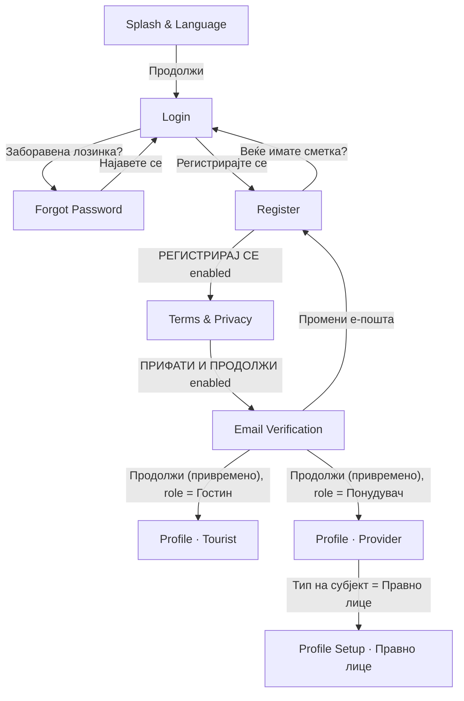
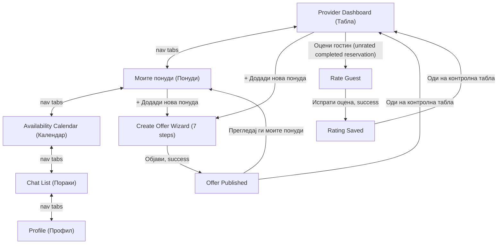
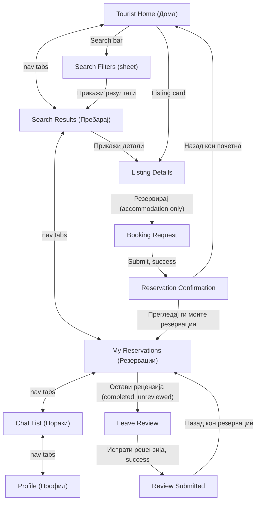
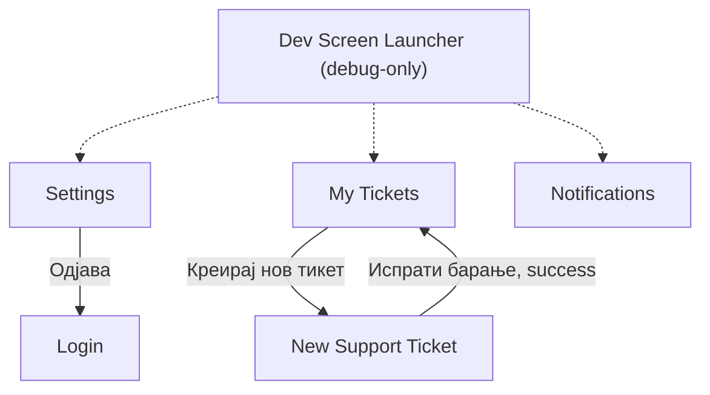

# Bulka — Project Progress

_Rural tourism app for Macedonia (Flutter). This page summarizes what has been built so far, how it's structured, and what's still open. Copy/paste this into the GitHub Wiki (e.g. as `Home` or `Project-Progress`) once you push the code._

## Where we left off

Last worked on: **the entire Tourist/Buyer side, end to end** — Home → Search Filters → Search Results → Listing Details → Booking → Reservation Confirmation → My Reservations → Leave Review → Review Submitted, plus a full audit/rewire of `TouristBottomNav` so all 5 tabs actually work. This closes the "Tourist has no shell" gap that was the top item here last time. Short-point summary below (see "Tourist/Buyer flow" section for detail); next up, whenever we pick this back up:

- **Map View is the single biggest unfinished piece.** "Карта" on Search Results is a `TODO` — building a *real* interactive map needs a package decision + `ProviderListing` coordinates + a way to collect them in the Create Offer wizard, none of which exist yet. Explicitly not faked with random coordinates. See "Known gaps" for the exact minimal plan once we're ready to pick a package.
- **Rejected/cancelled reservations are stored but not shown anywhere on My Reservations.** Product behavior for this is genuinely undecided (not a Figma gap — a real open question), flagged with a `TODO` right at the filtering point in `tourist_my_reservations_screen.dart`. Don't fold them into Upcoming/Past without deciding this first.
- **No "already reviewed" visual state exists**, same shape as the Provider "already rated" gap from last time — the action is disabled/dimmed (reusing the non-bookable-category pattern from Listing Details) rather than inventing a badge.
- **No Reservation Details screen exists** — "Прегледај детали" on My Reservations' upcoming cards is a real, styled, but inert `TODO`.
- **Settings, Notifications, My Tickets/New Ticket still have no real navigation entry point** for either role — only the Dev Launcher reaches them. Unchanged from last time.
- **Three explicit `TODO` actions remain on the Provider Offers screen** ("Уреди", "Уреди и поднеси повторно") — still blocked on an Edit Listing screen that doesn't exist. Unchanged from last time.
- Everything below this point reflects the actual current state of the code, not just intentions — cross-check `lib/` if anything here looks stale.

## Status at a glance

| Screen | Status | Notes |
|---|---|---|
| Splash & Language | ✅ Implemented | Vertically responsive on short devices |
| Login | ✅ Implemented | Google sign-in button is UI-only |
| Forgot Password | ✅ Implemented | "Send code" is UI-only |
| Register | ✅ Implemented | Submit gated on Terms checkbox |
| Terms & Privacy Acceptance | ✅ Implemented | Submit gated on all 3 consents |
| Email Verification | ✅ Implemented (with a temporary dev button, see below) | "Resend" is UI-only |
| Profile (Tourist) | ✅ Implemented | Pre-filled from registration data; Save gated on an actual edit; now hosts `TouristBottomNav` (`selectedIndex: 4`) |
| Profile (Provider · Физичко лице) | ✅ Implemented | Active Offers/Average Rating stat cards now derive from real listing + review data |
| Profile Setup (Provider · Правно лице) | ✅ Implemented | Full alternate screen (logo upload, business fields) shown when the subject-type toggle is set to "Правно лице" |
| Bottom Nav — Tourist / Provider | ✅ Implemented | **Both** roles fully wired now — `TouristBottomNav` centrally resolves all 5 tabs (Дома/Пребарај/Резервации/Пораки/Профил), mirroring `ProviderBottomNav`'s pattern |
| Tourist · Home (Дома) | ✅ Implemented | Search bar → Search Filters sheet; recommended listings from active `ProviderListing`s; category chips still `TODO` |
| Tourist · Search Filters (sheet) | ✅ Implemented | Keyword/location/price range/dates/rating/**guest count**/categories/amenities — one `ListingSearchFilter`, live result count |
| Tourist · Search Results | ✅ Implemented | List view only; quick-filter row; "Карта" button is `TODO` (see Map View below) |
| Tourist · Map View | ❌ Not started | Blocked on a real map-package + coordinates decision — see "Known gaps" |
| Tourist · Listing Details | ✅ Implemented | Gallery, favorites, host row, description, amenities, location placeholder, reviews, booking footer (accommodation-only) |
| Tourist · Booking Request | ✅ Implemented | **Not a Figma screen** — built from existing app primitives since no current-design frame defines this step |
| Tourist · Reservation Confirmation | ✅ Implemented | Always shows "request sent" wording — reservation starts `pending`, not auto-confirmed |
| Tourist · My Reservations | ✅ Implemented | Претстојни/Минати toggle; rejected/cancelled reservations intentionally not shown yet |
| Tourist · Leave Review | ✅ Implemented | Only reachable from a completed, not-yet-reviewed reservation |
| Tourist · Review Submitted | ✅ Implemented | "Назад кон резервации" → My Reservations, Минати tab |
| Provider Dashboard | ✅ Implemented | Hosts `ProviderBottomNav`; "Оцени гостин" now opens the real Rate Guest flow |
| Provider · Моите понуди (Offers) | ✅ Implemented | Listing photos now render correctly; 2 of its per-card actions are `TODO` (need an Edit Listing screen) |
| Provider · Availability Calendar | ✅ Implemented | Reachable via nav "Календар" |
| Provider · Create Offer Wizard (7 steps + Review) | ✅ Implemented | Reachable via both "+ Додади нова понуда" buttons (Dashboard, Offers) |
| Provider · Offer Published (Success) | ✅ Implemented | Reached only after a successful publish |
| Provider · Rate Guest | ✅ Implemented | Opened only from a completed reservation's "Оцени гостин" on the Dashboard |
| Provider · Rating Saved (Success) | ✅ Implemented | Reached only after a successful rating submit |
| Settings | ✅ Implemented | No screen navigates here yet; "Одjава" really logs out to Login |
| Notifications | ✅ Implemented | No screen navigates here yet |
| Messages · Chat List | ✅ Implemented | Reachable via "Пораки" on both the Tourist and Provider bottom nav; no bottom nav of its own (see "Confusing" section) |
| Messages · Chat Thread | ✅ Implemented | Reachable from Chat List only |
| Support · My Tickets | ✅ Implemented | No screen navigates here yet — reachable via Dev Launcher only |
| Support · New Ticket | ✅ Implemented | Reachable from My Tickets only |
| Dev Screen Launcher | ✅ Implemented (debug-only) | Boots automatically in debug builds; never present in release |
| Choose Role | ❌ Not started | No Figma frame implemented yet |
| Edit Listing screen | ❌ Not started | Blocks 2 Offers-screen actions |
| Reservation Details screen | ❌ Not started | Blocks 1 My Reservations action ("Прегледај детали") |
| Real Map View / coordinates | ❌ Not started | Needs a package + `ProviderListing` lat/lng decision — see "Known gaps" |
| Backend / API integration | ❌ Not started | All actions are local UI state only |

All screens above were built directly from the team's Figma file ("Rural Tourism"), matched frame-by-frame — colors, typography, spacing, and assets pulled from Figma via MCP rather than eyeballed.

## Navigation flow implemented so far

The original registration flow is unchanged and still the only "start to finish" wired path for a brand new user:



**The Provider role has a real, fully-connected shell**, all through `ProviderBottomNav` (every tap either switches tabs in place or `pushReplacement`s to the target screen — never a silent stacked push):



Note this diagram is a simplification — Dashboard/Offers/Calendar/Chat/Profile don't literally form a ring; every nav tap resolves independently to whichever of those 5 screens was tapped, from whichever one you're currently on. See "Provider Create Offer Wizard" and "Provider Rate Guest" below for exactly how exiting/cancelling and publishing/submitting manage the navigation stack, which is more involved than a simple push/pop.

**The Tourist role now has an equally real, fully-connected shell**, through `TouristBottomNav` (same "resolve centrally, guard against re-pushing the tab you're already on" pattern as `ProviderBottomNav`):



Same simplification note as the Provider diagram — the 5-tab ring is really "every tab resolves independently from wherever you are," not a literal cycle. `ListingDetailsScreen`/`BookingRequestScreen` carry an `originTabIndex` (0 from Home, 1 from Search Results) so the navbar highlights the section the user actually came from instead of hardcoding "Дома" — only `ReservationConfirmationScreen` onward switches to "Резервации", once a reservation genuinely exists. **Map View has no entry point yet** — Search Results' "Карта" button is a `TODO`.

**A third, separate cluster of screens still has no entry point from either flow above:**



Solid arrows are real, working `Navigator` transitions. Dashed arrows exist only in debug builds — in a release build there is currently **no way to reach Settings, My Tickets, New Ticket, or Notifications at all**.

**Data flow.** The name/email/phone entered on Register are carried forward via a small `RegistrationProfile` model passed as a constructor parameter screen-to-screen — no state-management library, just plain data passed down.

**Shared feature state** (Notifications, Chat, Support tickets, Provider listings, Reservations, Availability, Guest ratings, and now **Listing Reviews, Favorites, and Search**) all use the same pattern: a `ChangeNotifier` singleton per feature under `lib/services/`, listened to via manual `addListener`+`setState`. Any screen or widget can read the same singleton — this is what lets, for example, accepting a reservation on the Dashboard, publishing a new listing from the wizard, submitting a guest rating, or **a Tourist submitting a listing review, be visible everywhere that depends on it immediately** (Listing Details, Search Results, Provider Offers, Provider Profile's average rating, and the rating search filter all update live off the exact same `ListingReviewController`) with zero manual cross-screen sync.

**The Create Offer wizard uses a different, narrower pattern on purpose**: its `CreateListingDraft` is a plain **mutable object scoped to one wizard session** (owned by the wizard screen's own `State`, not a singleton) — see the wizard's own notes below for why. **The Search Filters sheet follows the same narrower pattern**: `ListingSearchFilter` is a mutable draft edited by one sheet session, only becoming the shared `SearchController.instance.filter` once "Прикажи резултати" is pressed.

## Screen-by-screen notes

**Splash & Language** (`lib/screens/splash_screen/`)
Solid green background, logo, title/subtitle, language switch (MK/SQ/EN), CTA. Vertically responsive (Galaxy S8+ / 360×740 tested). Covered by `test/splash_screen_responsive_test.dart`.

**Login / Forgot Password / Register / Terms & Privacy / Email Verification**
Unchanged since the last update. Register's role toggle drives which Profile screen Email Verification's temporary dev button routes to.

**Profile · Tourist** (`lib/screens/profile_screen/`)
Pre-filled from `RegistrationProfile`; Save disabled until an actual edit is made; Reservations/Favorite Places hardcoded at 0 (no such system exists yet). **This round**: gained `bottomNavigationBar: TouristBottomNav(selectedIndex: 4)` — it previously had none at all and was a dead end reachable only via the Dev Launcher.

**Profile · Provider (Физичко лице) / Profile Setup · Provider (Правно лице)** (`lib/screens/provider_profile_screen/`, one file)
Selecting "Правно лице" swaps the **entire** screen body (own header, logo upload, company fields, business details, additional contacts, real multi-photo picker) rather than just the personal-data fields. **Bugfix this round**: the "Активни понуди"/"Просечна оценка" stat cards were still `static const` hardcoded to `0` from before `ProviderListingController` existed — they're now derived getters (`ProviderListingController.instance.activeListingsCount`, and an average of active listings' own `rating` values), and the screen listens to the controller so both update live as listing statuses change elsewhere (e.g. a wizard-published listing getting approved, or an archived one being reactivated).

**Bottom Nav — Tourist / Provider** (`lib/widgets/bottom_nav_bar.dart`, `lib/widgets/app_bottom_nav.dart`)
**This round**: `TouristBottomNav` now resolves all 5 tabs centrally (Дома/Пребарај/Резервации/Пораки/Профил), exact same switch-and-guard-against-duplicate-push shape `ProviderBottomNav` already used — previously only "Пораки" worked and the other 4 taps were silent no-ops on every Tourist screen. `ProviderBottomNav` itself is untouched.

## Tourist / Buyer flow (this round)

Short points — see the code/commit history for full detail; every screen below is real, wired, and reading from shared state, not mocked in place.

- **`TouristHomeScreen`** (`lib/screens/tourist_home_screen/`) — recommended listings from `ProviderListingController.recommendedListings` (active only); search bar opens the Search Filters sheet; category chips still `TODO` (no destination screen for them yet).
- **Search Filters sheet** (`lib/screens/tourist_home_screen/search_filters_sheet.dart`) — one `ListingSearchFilter` model (keyword, location, price range, dates, rating, **guest count** — added this round alongside rating, not instead of it —, categories, amenities). Edits a local copy; only becomes the shared filter on "Прикажи резултати", which shows a **live** result count computed the same way the results screen itself filters.
- **`SearchController`** (`lib/services/search_controller.dart`) — the one shared "current search" singleton (filter + derived `matchingListings`), so Search Results and Map View (once built) always see the same result set without either screen owning its own copy.
- **`SearchResultsScreen`** (`lib/screens/search_results_screen/`) — list view of `SearchController`'s current matches; quick-filter row (category/rating chips + "Филтри"/"Цена" reopen the full sheet); "Карта" is a styled `TODO`.
- **`ListingDetailsScreen`** (`lib/screens/listing_details_screen/`) — photo gallery (swipeable, real `photoPaths`), favorite toggle (`FavoritesController`, local-only), host row, description, amenities (only what's actually set), location (map still a placeholder), reviews section (`ListingReviewController`), and a booking footer **gated to accommodation-category listings only** (`categoryRequiresPrice`) — other categories show the button dimmed/inert rather than a fake nights-based booking flow.
- **`BookingRequestScreen`** (`lib/screens/booking_request_screen/`) — **not a Figma screen.** No current-design frame defines a date/guest-count input step, so this reuses existing primitives instead of inventing new visual language: the same `showDateRangePicker` the filter sheet uses, plus a capacity stepper matching the Create Offer wizard's own guest-count row. Validates the picked range day-by-day against `AvailabilityController` (reused, not duplicated) before allowing submit.
- **`ReservationController.createReservation(...)`** — the one place a Tourist booking becomes a real `Reservation`: always starts **`pending`** (goes through the same Provider accept/reject queue every other reservation already does — this intentionally does *not* match Figma's literal "Резервацијата е потврдена!" wording, since that would misrepresent an unapproved booking as confirmed). Generates a local `bookingReference` (`RB-XXXXX`, collision-checked, `TODO`'d for a backend-issued one later) and snapshots `nightlyPriceAtBooking`/`serviceFee`/`totalAmount` at booking time so a later Provider price edit can never retroactively change an old reservation's total. `Reservation` also gained an optional `listingId` (backfilled onto existing mock reservations) — real relationship, not name-matching.
- **`ReservationConfirmationScreen`** (`lib/screens/reservation_confirmation_screen/`) — shows the just-created reservation's real data; wording says "request sent", matching the real `pending` status.
- **`TouristMyReservationsScreen`** (`lib/screens/tourist_my_reservations_screen/`) — Претстојни (`pending`+`accepted`) / Минати (`completed`) toggle, one shared `ReservationController` as the source, filtered to the current mock Tourist identity (`mockTouristGuestName`, see "Known gaps"). **`rejected`/`cancelled` reservations are intentionally shown in neither tab** — flagged, not silently dropped.
- **`LeaveReviewScreen` / `ReviewSubmittedScreen`** (`lib/screens/leave_review_screen/`, `lib/screens/review_submitted_screen/`) — reachable only from a completed, not-yet-reviewed reservation; already-reviewed reservations show the action dimmed/inert (reusing the same pattern as Listing Details' non-bookable categories) rather than a new invented "already reviewed" badge. Submits through `ListingReviewController.submitReview(...)`, which independently re-validates eligibility + no-duplicate regardless of what the UI already checked (same idiom as `GuestRatingController.submitRating`).
- **`ListingReviewController.effectiveRating(listing)`** — **the one authoritative rating calculation app-wide.** Real average of a listing's actual `ListingReview`s when any exist; falls back to the old stored `ProviderListing.rating` only for listings with zero reviews. **Every screen that shows a rating** (Listing Details, Search Results, Provider Offers, Provider Profile's average, and the search filter's rating threshold) now calls this instead of reading `listing.rating` directly — `ProviderListing.rating` itself is unchanged/still stored, just demoted to "fallback only."

**Provider Dashboard** (`lib/screens/provider_dashboard_screen/`)
"Контролна табла" — greeting derived from the provider's first listing's title, 3 counters derived from `ProviderListingController`/`ReservationController`, a "Резервации кои чекаат" section with working Прифати/Одбиј, and a "Завршени резервации" section. **"Оцени гостин" is now fully wired**: `_handleRateGuest(reservation)` checks `GuestRatingController.hasRating(reservation.id)` first — if already rated, it does nothing (no re-entry, no duplicate); otherwise it pushes `RateGuestScreen` with that exact `Reservation` object (no separate mock guest data — `guestName`/`listingName`/dates all come straight from the reservation already in hand). Hosts `ProviderBottomNav` at `selectedIndex: 0`.

**Provider · Моите понуди (Offers)** (`lib/screens/provider_offers_screen/`)
Renders entirely from `ProviderListingController.filteredListings(status: ...)`. 4 filter chips (Сите/Активни/На преглед/Одбиени, matching Figma exactly — archived listings show under "Сите" with no dedicated chip). Status pill/message/action per card driven by `ListingStatus`, never scattered strings. **Bugfix this round**: each card's image area was unconditionally rendering the flat placeholder color, even for listings with real picked photos (e.g. ones published via the Create Offer wizard) — it now renders `listing.photoPaths.first` via the shared `XFileImage` widget when present, falling back to the placeholder only for listings that genuinely have none. Only "Активирај повторно" is wired for real; "Уреди"/"Уреди и поднеси повторно" remain `TODO`s pending an Edit Listing screen.

**Provider · Availability Calendar** (`lib/screens/provider_availability_calendar_screen/`)
Unchanged since the last update — real `DateTime`-driven month calendar, `AvailabilityStatus` derived per-day (`occupied` always computed from `ReservationController`, `blocked` is the only real stored state), multi-select `Set<DateTime>` UI state kept separate from availability itself.

**Provider · Create Offer Wizard** (`lib/screens/create_offer_wizard_screen/`)
Unchanged since the last update — one route/one `StatefulWidget`, `_currentStep` swaps content, one shared mutable `CreateListingDraft`. See the previous revision of this doc (or the code itself) for the full step-by-step breakdown; the short version: 7 Figma steps + Review, per-step validation, a centralized `categoryRequiresPrice` rule, exit/cancel via a discard-confirmation dialog only when the draft has real content, and `ProviderListingController.createListing(draft)` on publish (always `status: pendingReview`).

**Provider · Offer Published (Success)** (`lib/screens/create_offer_success_screen/`)
Unchanged since the last update. Reached only via `pushReplacement`; both actions clear the entire stack down to one target screen via `pushAndRemoveUntil`.

**Provider · Rate Guest** (`lib/screens/rate_guest_screen/`) — new this round
Rates the guest of one specific `completed` `Reservation`, passed in directly (not looked up by id) from the Dashboard. Guest row shows a derived avatar (initials computed from `reservation.guestName`, same pattern used elsewhere in the app), name, and a listing+date-range+year context line (the year is a one-off composition local to this screen — no other screen using the shared `formatMkDateRange` shows one, so the shared formatter itself wasn't changed). A 5-star control (`agroGold100` filled / `agroBorder300` empty — exact Figma colors) drives a single `int _rating` (0 = unselected), plus an optional multi-line note. "Испрати оцена" is disabled until `_rating >= 1`. Submitting calls `GuestRatingController.submitRating(reservation:, rating:, note:)`, which independently re-validates both eligibility (`status == completed`) and no-duplicates regardless of what the UI already checked, then `pushReplacement`s to the Rating Saved screen.

**Provider · Rating Saved (Success)** (`lib/screens/rating_saved_screen/`) — new this round
Visually and structurally mirrors `CreateOfferSuccessScreen` (same check-circle/heading tokens, different top padding, only one action button instead of two). "Оди на контролна табла" does `pushAndRemoveUntil` to a fresh `ProviderDashboardScreen`, same pattern as the offer-published flow — Back can never return to a submitted rating form.

**Settings / Notifications / Messages / Support**
Unchanged since the last update.

**Dev Screen Launcher** (`lib/dev/dev_launcher_screen.dart`) — debug-only, not a Figma screen
Grew substantially this round — every new Tourist screen has its own entry (Home, Search Filters sheet standalone, Search Results, Listing Details, Booking Request, Reservation Confirmation, My Reservations, Leave Review, Review Submitted), several seeding real mock data on tap (e.g. creating a real `pending`/`completed` reservation) so the screen isn't empty when opened in isolation. Still wired the same way, zero effect on release builds.

## Architecture / design system

**From the Rate Guest round:**
- **`lib/widgets/xfile_image.dart`** — **`Image.file`/`FileImage` (both backed by `dart:io`) hard-fail on Flutter Web** — the browser has no real filesystem. `XFileImage`/`xfileImageProvider` branch on `kIsWeb`: `Image.network`/`NetworkImage` on web (a picked file's `.path` is a `blob:` URL there), `Image.file`/`FileImage` everywhere else. Used everywhere the app renders a locally-picked image, including every new Tourist card/gallery this round.
- **`GuestRating`/`GuestRatingController`** — Provider rates a guest after a completed reservation. `submitRating` enforces "only completed" + "no duplicates"; safe to call regardless of what the UI already checked.

**From this round (Tourist/Buyer flow) — new models:**
- **`ListingSearchFilter`** (`lib/models/`) — mutable search-filter draft (keyword, location, price range, dates, rating, guest count, categories, amenities). Edited by the Search Filters sheet; committed to `SearchController` on apply.
- **`ListingReview`** (`lib/models/`) — a guest's review of a *listing*, deliberately the opposite direction from `GuestRating` (different author, different subject). Has `reservationId` (nullable — the 2 original mock reviews predate this relationship) as the duplicate-review boundary.
- **`Reservation`** extended with `listingId` (real FK, backfilled onto mock data), `bookingReference`, `nightlyPriceAtBooking`, `serviceFee`, `totalAmount` — a price/reference *snapshot* taken at booking time, deliberately not re-derived from the listing's current price later.

**New services:**
- **`SearchController`** — holds the Tourist's *current* search (filter + derived `matchingListings`), so Search Results/Map View share one result set instead of each owning a copy.
- **`ListingReviewController`** — `reviewsForListing`, `hasReviewForReservation`, **`effectiveRating(listing)`** (the one authoritative rating calc — see "Tourist / Buyer flow" above), `submitReview` (same "re-validate regardless of UI" idiom as `GuestRatingController.submitRating`).
- **`FavoritesController`** — local `Set<String>` of favorited listing ids; `toggle`/`isFavorite`. No backend sync yet.
- **`ReservationController.createReservation(...)`** — the one place a real Tourist booking is created; see "Tourist / Buyer flow" above for what it snapshots and why it always starts `pending`.

**New shared constant:**
- **`lib/core/constants/mock_tourist_identity.dart`** — `mockTouristGuestName` ("Јована Јованова"), the one place "who is the current Tourist" is defined, since there's no auth. Used by `BookingRequestScreen` (as `guestName`), `TouristMyReservationsScreen` (as the ownership filter), and `LeaveReviewScreen` (as `authorName`) — previously this was a private constant duplicated only in `BookingRequestScreen`.

- Everything else (colors/dimensions/strings conventions, `ProviderListingController`, `AvailabilityController`, `CreateListingDraft`, the wizard's shared widgets) is unchanged in shape — `ProviderListingController.searchListings` and a few Provider-side rating displays were extended (not rewritten) to call `ListingReviewController.effectiveRating` — see the codebase for specifics.

## Known gaps / not yet implemented

**Carried over from before:**
- **No backend or API wiring anywhere.** Every "submit"/"save"/"send"/"publish"/"rate"/"review"/"book" action across every screen is local state only, with a `TODO` marking where a real API call would go.
- **Most of the older secondary screens still have no real navigation entry point.** Settings, Notifications, My Tickets, and New Ticket are only reachable via the Dev Screen Launcher (debug builds only) or each other's internal navigation.
- **No "already rated" visual treatment** on Provider Dashboard's "Оцени гостин" (unchanged from last time) — the exact same shape of gap now also exists for Tourist's "Остави рецензија" (see below), so there are now two places waiting on the same kind of design.
- **No Edit Listing screen** — blocks "Уреди"/"Уреди и поднеси повторно" on Provider Offers.
- **Verification status** on the Provider profile is still hardcoded to "not verified."
- **Choose Role screen** still has no Figma frame implemented.
- **Temporary dev button** on Email Verification still needs removal once real email verification exists.
- **Everything is lost on app restart** — no persistence layer exists for any in-memory singleton (now including Tourist searches/reviews/favorites/reservations too).
- Test coverage is still limited to the Splash screen's responsive-layout behavior.

**New this round (Tourist/Buyer flow):**
- **Map View has no real implementation.** `SearchResultsScreen`'s "Карта" button is a styled `TODO`. Building the *real* thing (not a decorative placeholder — explicitly ruled out) needs, at minimum: (1) picking a map package (no map package is in `pubspec.yaml` today), (2) adding nullable `latitude`/`longitude` to `ProviderListing`, (3) a way to actually collect them — the Create Offer wizard's location step is still a static pin placeholder with its own pre-existing `TODO`. None of this exists yet; do not invent random coordinates to make markers render.
- **`rejected`/`cancelled` reservations don't appear on `TouristMyReservationsScreen` at all.** Not silently hidden — they're still fully present in `ReservationController`'s shared state — but neither the Претстојни nor Минати tab renders them, because where they belong is a genuinely open product question, not something Figma or existing code defines. `TODO`'d at the exact filtering point.
- **No "already reviewed" visual treatment** for `TouristMyReservationsScreen`'s "Остави рецензија" — mirrors the Provider "already rated" gap exactly. The action is disabled/dimmed (reusing the existing non-bookable-category pattern from Listing Details) so it's at least not misleadingly "active", but no real badge/label design exists yet.
- **No Reservation Details screen** — "Прегледај детали" on upcoming reservation cards is a real, styled, but inert `TODO`. The card already carries the exact `Reservation`/`ProviderListing` such a screen would need.
- **No Tourist booking/reservation identity beyond a shared mock constant.** `mockTouristGuestName` stands in for "the logged-in Tourist" everywhere (My Reservations' ownership filter, booking creation, review authorship) — there's no real user/account model or session anywhere in the app. A real implementation needs an actual user id on `Reservation`/`ListingReview`, not a name match.
- **Booking reference (`RB-XXXXX`) and internal reservation ids are locally generated, incrementing counters** — collision-checked against current in-memory state only, not authoritative. A real backend should own generating/guaranteeing these.
- **Service fee is a flat placeholder 7.5% of subtotal** (`lib/core/utils/booking_price.dart`), not a quoted business rule — isolated in one helper so it's a one-line change once a real pricing rule exists.
- **Date-range filtering doesn't actually check availability.** `ListingSearchFilter.startDate`/`endDate` are stored and shown in the UI, but `ProviderListingController.searchListings` doesn't exclude listings that are unavailable for those dates — there's no cross-listing "is this listing free on date X" query surface today (`AvailabilityController` is per-listing, built for the Provider's own calendar). Flagged with a `TODO` at the exact spot in `searchListings`; never silently shows something as available when it isn't known to be.
- **Category filter chips in the Search Filters sheet are multi-select** — a judgment call (Figma's mockup only shows one example chip highlighted, not a stated interaction rule), not an explicit spec. Worth double-checking against the real prototype if that ever gets clarified.
- **Location/date pickers in the Search Filters sheet are custom-built**, not literal Figma "open state" reproductions (Figma only shows the closed field) — a location bottom-sheet list and Flutter's built-in `showDateRangePicker`, themed to match.

## Confusing / worth knowing before touching this again

Things that aren't bugs, but aren't obvious from reading the code cold either:

- **The Figma file has a second, entirely different "01–14" numbered frame set** (Splash, Choose Role, Home, Filter, Property Detail, Calendar Picker, Availability, Booking Confirmation, Messages, Profile Edit, Map View) using a completely different visual design system — different green (`#118e43` vs. the app's real `agro-forest-950`), different fonts/tokens, an MK/AL/EN language switch styled nothing like the real one. **None of the implemented app is based on these** — they're an earlier, superseded design pass. If a frame link ever resolves to one of these, it's the wrong one; the real design system is the "20–27 – Buyer ·"/equivalent Provider-numbered frames.
- **`BookingRequestScreen` has no Figma design at all.** It was built from existing app primitives (the filter sheet's date picker, the wizard's capacity stepper) because no current-design frame defines a date/guest-count input step between Listing Details and the booking confirmation. If a real frame for this ever gets designed, this screen should be reconciled against it rather than assumed correct forever.
- **Guest count in the search filter is a *minimum threshold* ("2+"), not an exact headcount** — conceptually different from `Reservation.guestCount` (a real booking's exact number of guests), even though both render as "N гости" in different places. Don't conflate the two if extending either.
- **Villa Zdravkovski's displayed rating visibly changed from 4.8 to 5.0** the moment review-based rating aggregation shipped, with no user action involved — it already had 2 seeded reviews (5, 5) that were previously disconnected from the displayed number. This is correct (the review collection is now the one authoritative source), not a regression, but it can look like one if you're comparing screenshots before/after.
- **`ListingDetailsScreen`/`BookingRequestScreen`'s selected nav tab depends on where the user came from** (`originTabIndex`, 0 from Home / 1 from Search Results), not a fixed value. Any *new* entry point into either screen needs to explicitly pass the right origin — the default is 0, which will silently look right coming from Home and silently wrong coming from anywhere else.
- **`ChatListScreen` has no bottom nav for either role**, on purpose (pre-existing, unchanged) — it's a push-only destination. "Messages → another tab" works by using its own back button (which returns to whichever navbar-equipped screen opened it), not by tapping a tab from inside Messages itself.
- **"Оценка" (rating) vs. "Број на гости" (guest count) in the filter sheet were originally either/or in the spec, then both were confirmed needed** — the sheet keeps both as separate rows on purpose; don't "simplify" this back down to one without checking history first.

## Running the project

```bash
flutter pub get
flutter run          # debug build boots into the Dev Screen Launcher — see below
flutter analyze
flutter test
```

**Testing an individual screen without walking the real flow:** just `flutter run` (no `--release`) — debug builds boot straight into the Dev Screen Launcher (`lib/dev/dev_launcher_screen.dart`) instead of Splash, and every implemented screen is one tap away, using its real widget and real controllers/state. This has no effect on release builds, which always start at `SplashScreen`.